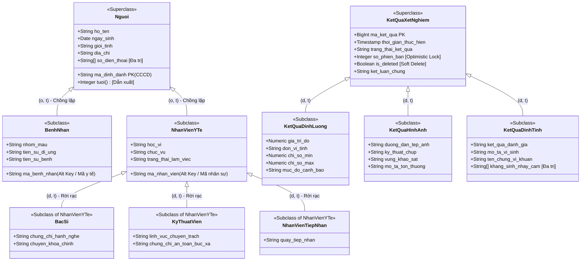
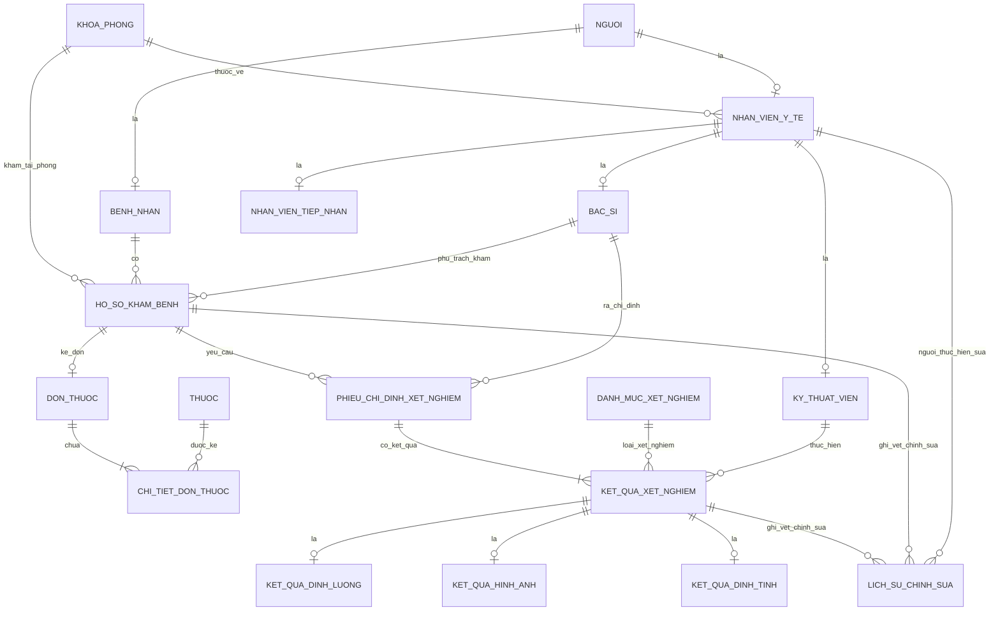

# 📐 ĐẶC TẢ THIẾT KẾ MỨC QUAN NIỆM (EER - ENHANCED ENTITY-RELATIONSHIP)
## Đề tài: CSDL Hồ sơ Khám bệnh và Kết quả Xét nghiệm có Lịch sử Chỉnh sửa

---

## 1. MÔ HÌNH CHUYÊN BIỆT HÓA / TỔNG QUÁT HÓA (GENERALIZATION / SPECIALIZATION)

Đồ án ứng dụng hai cấu trúc kế thừa chính nhằm đáp ứng chuẩn đầu ra của CSDL Nâng cao:
1. **Phân cấp Người (Person Hierarchy)**: 
   - Cấp 1 (`Nguoi` ⟶ `BenhNhan`, `NhanVienYTe`): **Chồng lặp (Overlapping), Toàn phần (Total) `(o, t)`**.
   - Cấp 2 (`NhanVienYTe` ⟶ `BacSi`, `KyThuatVien`, `NhanVienTiepNhan`): **Rời rạc (Disjoint), Toàn phần (Total) `(d, t)`**.
2. **Phân cấp Kết quả xét nghiệm (Lab Result Hierarchy - Đa hình)**: **Rời rạc (Disjoint), Toàn phần (Total) `(d, t)`**.

### 1.1. Sơ đồ phân cấp kế thừa

### 1.2. Giải thích ràng buộc kế thừa & Xử lý bài toán Bác sĩ đi khám bệnh

#### A. Phân cấp Cụm Con người:
- **Ràng buộc Chồng lặp (Overlapping - `o`) giữa `BenhNhan` và `NhanVienYTe`**:
  - **Thực tế nghiệp vụ**: Bác sĩ, kỹ thuật viên hay nhân viên tiếp nhận khi bị ốm đau hoàn toàn có thể đăng ký khám bệnh tại chính bệnh viện nơi mình đang công tác.
  - **Giải pháp kiến trúc**: Thiết kế dạng **Chồng lặp (Overlapping)** giúp một thực thể `Nguoi` có thể đồng thời đóng hai vai trò: vừa là `NhanVienYTe` (có mã nhân viên, quản lý ca trực, lương, chứng chỉ hành nghề), vừa là `BenhNhan` (có mã bệnh nhân, hồ sơ bệnh án, tiền sử dị ứng, kết quả xét nghiệm).
  - **Lợi ích chuẩn hóa**: Thông tin định danh công dân duy nhất (`ma_dinh_danh` - CCCD, họ tên, ngày sinh, giới tính, số điện thoại) chỉ lưu tại đúng một nơi (`Nguoi`). Tránh triệt để dị thường dư thừa dữ liệu (Redundancy) và bất nhất dữ liệu khi cập nhật thông tin cá nhân.
- **Ràng buộc Toàn phần (Total - `t`)**: Mọi người được lưu trong hệ thống bệnh viện đều phải là Bệnh nhân hoặc Cán bộ y tế (hoặc cả hai).
- **Ràng buộc Rời rạc (Disjoint - `d`) trong `NhanVienYTe`**: Trong cùng một hợp đồng lao động/vị trí chuyên môn, một nhân viên chỉ đảm nhận một chức danh chính: hoặc là `BacSi`, hoặc là `KyThuatVien`, hoặc là `NhanVienTiepNhan`.

#### B. Phân cấp Kết quả xét nghiệm:
- **Ràng buộc Rời rạc (Disjoint - `d`) & Toàn phần (Total - `t`)**: Một kết quả xét nghiệm cụ thể bắt buộc phải thuộc về đúng một trong ba hình thái: định lượng số học, chẩn đoán hình ảnh, hoặc định tính vi sinh. Không thể có một kết quả vừa là ảnh X-quang vừa là chỉ số đo đường huyết trên cùng một dòng dữ liệu.

---

## 2. CÁC THUỘC TÍNH ĐẶC BIỆT TRONG MÔ HÌNH

### 2.1. Thuộc tính đa trị (Multi-valued Attributes)
- **`so_dien_thoai` trong thực thể `Nguoi`**: Một người có thể có nhiều số điện thoại liên lạc (số cá nhân, số người thân bảo lãnh). Thuộc tính này sẽ được hiện thực hóa bằng kiểu mảng `TEXT[]` trong PostgreSQL hoặc bảng phụ khi chuẩn hóa.
- **`khang_sinh_nhay_cam` trong `KetQuaDinhTinh`**: Kết quả nuôi cấy vi sinh có thể cho ra một danh sách các loại kháng sinh nhạy cảm (`TEXT[]`).

### 2.2. Thuộc tính dẫn xuất (Derived Attributes)
- **`tuoi` trong `Nguoi` / `BenhNhan`**: Được tính toán tự động dựa trên ngày sinh và ngày hiện tại:
  $$\text{tuoi} = \text{EXTRACT(YEAR FROM CURRENT\_DATE)} - \text{EXTRACT(YEAR FROM ngay\_sinh)}$$
- **`bmi` trong `HoSoKhamBenh`**: Được dẫn xuất từ chiều cao và cân nặng:
  $$\text{BMI} = \frac{\text{can\_nang (kg)}}{\left(\frac{\text{chieu\_cao (cm)}}{100}\right)^2}$$

### 2.3. Thực thể yếu (Weak Entity) & Mối quan hệ xác định (Identifying Relationship)
- **`ChiTietDonThuoc` là thực thể yếu** phụ thuộc hoàn toàn vào thực thể chủ `DonThuoc`.
  - **Khóa cục bộ (Partial Key / Discriminator)**: `so_thu_tu_dong` (STT dòng thuốc trong đơn).
  - **Khóa chính đầy đủ**: Hợp của khóa chính thực thể chủ `ma_don_thuoc` và `so_thu_tu_dong`.
  - Nếu một `DonThuoc` bị xóa hoặc hủy, toàn bộ các `ChiTietDonThuoc` cấu thành đơn đó sẽ bị xóa lan truyền (`ON DELETE CASCADE`).

### 2.4. Cơ chế Quản lý Phiên bản & Kiểm soát Cạnh tranh (Versioning, Soft Delete & Concurrency)
- **Cột `so_phien_ban` (INT DEFAULT 1)**: Đóng vai trò vừa lưu số lần điều chỉnh, vừa là token phục vụ **Khóa lạc quan (Optimistic Locking)**. Khi kiểm thử Concurrency ở Tuần 11, hai kỹ thuật viên cùng sửa một kết quả đo lường, phiên thao tác sau sẽ bị chặn (Conflict Detection) để chống lỗi mất cập nhật (Lost Update).
- **Cờ `is_deleted` (BOOLEAN DEFAULT FALSE)**: Đảm bảo nguyên tắc y tế không bao giờ xóa cứng (Hard Delete). Mọi thao tác hủy bỏ đều là Soft Delete (`is_deleted = TRUE`).
- **Bảng `LichSuChinhSua` (Audit Log)**: Lưu trữ các snapshot toàn diện dạng `JSONB` của dữ liệu trước (`old_data`) và sau (`new_data`), thời điểm, người thực hiện và lý do bắt buộc. Bác sĩ truy xuất kết quả hiện hành cực nhanh qua bảng chính (`WHERE is_deleted = FALSE`), trong khi cơ quan giám định có thể tra cứu toàn bộ lịch sử biến động từ `LichSuChinhSua`.

---

## 3. SƠ ĐỒ THỰC THỂ KẾT HỢP EER TỔNG THỂ (CROW'S FOOT NOTATION)

---

## 4. MA TRẬN MỐI QUAN HỆ VÀ BẢN SỐ (CARDINALITY & PARTICIPATION)

| Mối quan hệ | Thực thể 1 | Bản số 1 (Min..Max) | Thực thể 2 | Bản số 2 (Min..Max) | Ý nghĩa nghiệp vụ |
|---|---|---|---|---|---|
| **Khoa - Nhân viên** | `KhoaPhong` | 1..1 (Total) | `NhanVienYTe` | 0..N (Partial) | Một nhân viên bắt buộc thuộc về 1 khoa/phòng; một khoa có thể có nhiều nhân viên. |
| **Bệnh nhân - Hồ sơ khám**| `BenhNhan` | 1..1 (Total) | `HoSoKhamBenh` | 0..N (Partial) | Một hồ sơ khám phải thuộc đúng 1 bệnh nhân; bệnh nhân có thể chưa hoặc đã khám nhiều lần. |
| **Bác sĩ - Hồ sơ khám** | `BacSi` | 1..1 (Total) | `HoSoKhamBenh` | 0..N (Partial) | Bác sĩ khám phụ trách hồ sơ khám bệnh. |
| **Hồ sơ - Đơn thuốc** | `HoSoKhamBenh`| 1..1 (Total) | `DonThuoc` | 0..1 (Partial) | Một hồ sơ khám bệnh có tối đa 1 đơn thuốc; một đơn thuốc thuộc về duy nhất 1 hồ sơ khám. |
| **Đơn thuốc - Chi tiết** | `DonThuoc` | 1..1 (Total) | `ChiTietDonThuoc`| 1..N (Total) | Đơn thuốc là thực thể chủ; phải có ít nhất 1 dòng thuốc chi tiết. |
| **Thuốc - Chi tiết đơn** | `Thuoc` | 1..1 (Total) | `ChiTietDonThuoc`| 0..N (Partial) | Một thuốc có thể xuất hiện trong nhiều chi tiết đơn thuốc. |
| **Hồ sơ - Phiếu chỉ định**| `HoSoKhamBenh`| 1..1 (Total) | `PhieuChiDinhXN`| 0..N (Partial) | Một đợt khám có thể không chỉ định hoặc chỉ định nhiều phiếu xét nghiệm. |
| **Phiếu - Kết quả xét nghiệm**| `PhieuChiDinhXN`| 1..1 (Total) | `KetQuaXetNghiem`| 1..N (Total) | Mỗi phiếu chỉ định bao gồm 1 hoặc nhiều hạng mục kết quả xét nghiệm. |
| **Kỹ thuật viên - Kết quả** | `KyThuatVien` | 0..1 (Partial) | `KetQuaXetNghiem`| 0..N (Partial) | Khi chưa có kết quả thì chưa gán KTV; khi đã thực hiện bắt buộc có KTV phụ trách. |
| **Bản ghi - Lịch sử chỉnh sửa**| Thực thể nguồn | 1..1 (Total) | `LichSuChinhSua`| 0..N (Partial) | Khi bản ghi phát sinh UPDATE, một dòng lịch sử vết sẽ được ghi nhận. |

