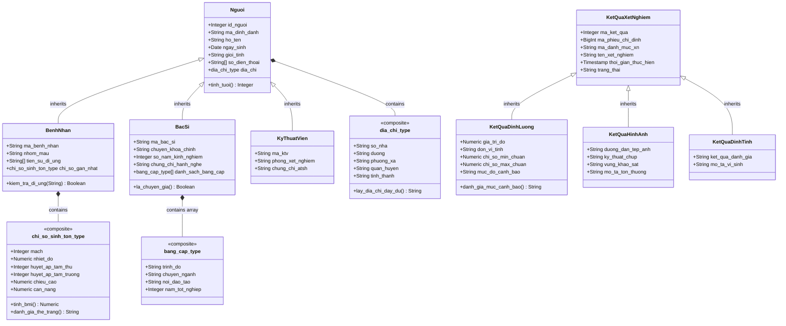

# 🧬 TÀI LIỆU THIẾT KẾ CƠ SỞ DỮ LIỆU HƯỚNG ĐỐI TƯỢNG (ORDBMS & OQL)
## Đề tài: CSDL Hồ sơ Khám bệnh và Kết quả Xét nghiệm có Lịch sử Chỉnh sửa
*(Đáp ứng Chuẩn đầu ra 4: CSDL Hướng đối tượng & OQL — 1.5 điểm)*

---

## 1. TỔNG QUAN KIẾN TRÚC HƯỚNG ĐỐI TƯỢNG - QUAN HỆ (ORDBMS)

Mô hình Cơ sở dữ liệu Hướng đối tượng - Quan hệ (**Object-Relational DBMS - ORDBMS**) là sự kết hợp tối ưu giữa tính toàn vẹn, khả năng truy vấn mạnh mẽ của mô hình quan hệ (RDBMS) và tính đóng gói, kế thừa, đa hình của lập trình hướng đối tượng (OOP).

Trong hệ quản trị **PostgreSQL 16**, các tính năng ORDBMS cốt lõi được ứng dụng trong đề tài bao gồm:
1. **Kiểu dữ liệu phức hợp (Composite Types):** Đóng gói nhiều thuộc tính liên quan thành một cấu trúc logic duy nhất (`dia_chi_type`, `chi_so_sinh_ton_type`, `bang_cap_type`).
2. **Kế thừa bảng (Table Inheritance):** Cho phép bảng con kế thừa toàn bộ thuộc tính, ràng buộc từ bảng cha (`INHERITS`), hỗ trợ truy vấn đa hình (`Polymorphic Query`).
3. **Thuộc tính đa trị (Collection-oriented / Arrays):** Lưu trữ danh sách phần tử nguyên thủy (`TEXT[]`) hoặc mảng các đối tượng phức hợp (`oop.bang_cap_type[]`).
4. **Phương thức đối tượng (Object Methods):** Đóng gói logic nghiệp vụ (tính tuổi, tính BMI, phân loại thể trạng, đánh giá cảnh báo, kiểm tra dị ứng) trực tiếp trên các hàng hoặc kiểu dữ liệu đối tượng.
5. **Truy vấn hướng đối tượng OQL (Object Query Language):** Hiện thực chuẩn **ODMG 3.0** và ánh xạ trực tiếp sang cú pháp SQL nâng cao của PostgreSQL.

---

## 2. SƠ ĐỒ HỆ PHÂN CẤP LỚP ĐỐI TƯỢNG (CLASS HIERARCHY)



---

## 3. ĐẶC TẢ CÁC KIỂU PHỨC HỢP & PHƯƠNG THỨC ĐỐI TƯỢNG

### 3.1. Các kiểu dữ liệu phức hợp (`Composite Types`)
1. **`oop.dia_chi_type`:** Đóng gói thông tin địa chỉ hành chính gồm: `so_nha`, `duong`, `phuong_xa`, `quan_huyen`, `tinh_thanh`.
2. **`oop.chi_so_sinh_ton_type`:** Đóng gói toàn diện các chỉ số khám thực thể lâm sàng của bệnh nhân: `mach` (lần/phút), `nhiet_do` (°C), `huyet_ap_tam_thu` (mmHg), `huyet_ap_tam_truong` (mmHg), `chieu_cao` (cm), `can_nang` (kg).
3. **`oop.bang_cap_type`:** Đóng gói văn bằng y khoa của bác sĩ: `trinh_do`, `chuyen_nganh`, `noi_dao_tao`, `nam_tot_nghiep`.

### 3.2. Hệ thống phương thức thành viên (`Member Methods`)
- **`oop.tinh_tuoi(oop.nguoi)`:** Tính tuổi hiện tại từ ngày sinh của đối tượng `Nguoi` và tất cả các lớp con (`BenhNhan`, `BacSi`, `KyThuatVien`).
- **`oop.lay_dia_chi_day_du(oop.dia_chi_type)`:** Ghép các thành phần địa chỉ thành một chuỗi văn bản hoàn chỉnh chuẩn hóa.
- **`oop.tinh_bmi(oop.chi_so_sinh_ton_type)`:** Phương thức tính chỉ số khối cơ thể $BMI = \frac{\text{Cân nặng (kg)}}{(\text{Chiều cao (m)})^2}$.
- **`oop.danh_gia_the_trang(oop.chi_so_sinh_ton_type)`:** Phân loại thể trạng theo tiêu chuẩn WHO dành cho người châu Á (IDI & WPRO): Gầy, Bình thường, Thừa cân, Béo phì độ I, Béo phì độ II.
- **`oop.danh_gia_muc_canh_bao(oop.ket_qua_dinh_luong)`:** Đánh giá động mức độ bất thường của chỉ số xét nghiệm (`NGUY_HIEM_THAP`, `THAP`, `BINH_THUONG`, `CAO`, `NGUY_HIEM_CAO`).
- **`oop.kiem_tra_di_ung(oop.benh_nhan, text)`:** Kiểm tra tương tác dị ứng thuốc trên mảng dị nguyên của bệnh nhân.
- **`oop.la_chuyen_gia(oop.bac_si)`:** Xác định bác sĩ có phải chuyên gia cấp cao (kinh nghiệm $\ge 10$ năm hoặc có bằng `BS.CKII` / `Tiến sĩ`).

---

## 4. CHI TIẾT 6 TRUY VẤN OQL (ODMG 3.0) & ÁNH XẠ POSTGRESQL SQL

### 4.1. Truy vấn OQL 1: Lời gọi phương thức (Method Invocation & Encapsulation)
- **Ý nghĩa nghiệp vụ:** Tìm danh sách bệnh nhân có nguy cơ béo phì ($BMI \ge 25.0$), gọi các phương thức đóng gói trên đối tượng để tính tuổi, BMI và phân loại thể trạng.
- **Cú pháp OQL (ODMG 3.0):**
```oql
SELECT bn.ma_benh_nhan, bn.ho_ten, bn.tinh_tuoi(), 
       bn.chi_so_gan_nhat.tinh_bmi(), bn.chi_so_gan_nhat.danh_gia_the_trang()
FROM BenhNhan bn
WHERE bn.chi_so_gan_nhat.tinh_bmi() >= 25.0;
```
- **Ánh xạ sang PostgreSQL SQL:**
```sql
SELECT 
    bn.ma_benh_nhan,
    bn.ho_ten,
    oop.tinh_tuoi(bn) AS tuoi,
    (bn.chi_so_gan_nhat).chieu_cao AS chieu_cao_cm,
    (bn.chi_so_gan_nhat).can_nang AS can_nang_kg,
    oop.tinh_bmi(bn.chi_so_gan_nhat) AS chi_so_bmi,
    oop.danh_gia_the_trang(bn.chi_so_gan_nhat) AS phan_loai_the_trang
FROM oop.benh_nhan bn
WHERE oop.tinh_bmi(bn.chi_so_gan_nhat) >= 25.0;
```
- **Kết quả thực thi mẫu:**
```text
 ma_benh_nhan |    ho_ten     | tuoi | chieu_cao_cm | can_nang_kg | chi_so_bmi | phan_loai_the_trang 
--------------+---------------+------+--------------+-------------+------------+---------------------
 BN-OOP-01    | Nguyễn Văn An |   61 |       168.00 |       74.50 |      26.40 | Béo phì độ I
 BN-OOP-03    | Lê Hoàng Long |   38 |       175.00 |       88.00 |      28.73 | Béo phì độ I
(2 rows)
```

---

### 4.2. Truy vấn OQL 2: Truy vấn trên tập hợp đa trị (Nested Collection / Array)
- **Ý nghĩa nghiệp vụ:** Tìm bệnh nhân có tiền sử dị ứng thuốc với hoạt chất Penicillin và sở hữu từ 2 số điện thoại liên lạc trở lên để gửi thông báo khẩn cấp.
- **Cú pháp OQL (ODMG 3.0):**
```oql
SELECT bn.ma_benh_nhan, bn.ho_ten, bn.so_dien_thoai, bn.tien_su_di_ung
FROM BenhNhan bn
WHERE "Penicillin" IN bn.tien_su_di_ung
  AND count(bn.so_dien_thoai) >= 2;
```
- **Ánh xạ sang PostgreSQL SQL:**
```sql
SELECT 
    bn.ma_benh_nhan,
    bn.ho_ten,
    bn.so_dien_thoai,
    bn.tien_su_di_ung,
    oop.kiem_tra_di_ung(bn, 'Penicillin') AS co_xung_dot_penicillin
FROM oop.benh_nhan bn
WHERE 'Penicillin' = ANY(bn.tien_su_di_ung)
  AND cardinality(bn.so_dien_thoai) >= 2;
```
- **Kết quả thực thi mẫu:**
```text
 ma_benh_nhan |    ho_ten     |      so_dien_thoai      |    tien_su_di_ung    | co_xung_dot_penicillin 
--------------+---------------+-------------------------+----------------------+------------------------
 BN-OOP-01    | Nguyễn Văn An | {0909123456,0913123456} | {Penicillin,Aspirin} | t
(1 row)
```

---

### 4.3. Truy vấn OQL 3: Kế thừa và Truy vấn Đa hình (Inheritance & Polymorphic Query)
- **Ý nghĩa nghiệp vụ:** Truy vấn tập trung danh mục toàn bộ kết quả cận lâm sàng của bệnh viện thông qua lớp cơ sở `KetQuaXetNghiem`. Nhờ cơ chế đa hình, CSDL tự động duyệt qua tất cả các lớp con kế thừa (`KetQuaDinhLuong`, `KetQuaHinhAnh`, `KetQuaDinhTinh`) mà không cần thực hiện phép `UNION`.
- **Cú pháp OQL (ODMG 3.0):**
```oql
SELECT kq.ma_ket_qua, kq.ten_xet_nghiem, kq.thoi_gian_thuc_hien, kq.trang_thai
FROM KetQuaXetNghiem kq;
```
- **Ánh xạ sang PostgreSQL SQL:**
```sql
SELECT 
    tableoid::regclass AS bang_con_ke_thua,
    kq.ma_ket_qua,
    kq.ten_xet_nghiem,
    kq.thoi_gian_thuc_hien,
    kq.trang_thai
FROM oop.ket_qua_xet_nghiem kq
ORDER BY kq.ma_ket_qua;
```
- **Kết quả thực thi mẫu:**
```text
    bang_con_ke_thua    | ma_ket_qua |           ten_xet_nghiem            | thoi_gian_thuc_hien | trang_thai 
------------------------+------------+-------------------------------------+---------------------+------------
 oop.ket_qua_dinh_luong |          1 | Định lượng Glucose máu              | 2026-11-01 08:30:00 | HOAN_THANH
 oop.ket_qua_dinh_luong |          2 | Định lượng Cholesterol toàn phần    | 2026-11-01 08:30:00 | HOAN_THANH
 oop.ket_qua_dinh_luong |          3 | Định lượng Ure huyết thanh          | 2026-11-02 09:15:00 | HOAN_THANH
 oop.ket_qua_dinh_luong |          4 | Định lượng Triglycerid máu          | 2026-11-03 10:00:00 | HOAN_THANH
 oop.ket_qua_hinh_anh   |          5 | Chụp X-quang tim phổi thẳng         | 2026-11-01 09:00:00 | HOAN_THANH
 oop.ket_qua_hinh_anh   |          6 | Siêu âm ổ bụng tổng quát            | 2026-11-03 10:30:00 | HOAN_THANH
 oop.ket_qua_dinh_tinh  |          7 | Xét nghiệm Viêm gan B (HBsAg nhanh) | 2026-11-02 09:45:00 | HOAN_THANH
 oop.ket_qua_dinh_tinh  |          8 | Test vi khuẩn H.Pylori dạ dày       | 2026-11-04 14:00:00 | HOAN_THANH
(8 rows)
```

---

### 4.4. Truy vấn OQL 4: Biểu thức đường dẫn (Path Expressions & Nested Composites)
- **Ý nghĩa nghiệp vụ:** Điều hướng truy cập thuộc tính đa cấp thông qua toán tử dấu chấm (`.`): Từ Hồ sơ khám bệnh điều hướng đến địa chỉ lồng nhau (`dia_chi.tinh_thanh`, `dia_chi.quan_huyen`) của bệnh nhân và thông tin chuyên môn của bác sĩ điều trị.
- **Cú pháp OQL (ODMG 3.0):**
```oql
SELECT hs.ma_ho_so, hs.thoi_gian_kham, hs.chan_doan,
       hs.benh_nhan.ho_ten, hs.benh_nhan.dia_chi.tinh_thanh,
       hs.bac_si_kham.ho_ten, hs.bac_si_kham.chuyen_khoa_chinh
FROM HoSoKhamBenh hs;
```
- **Ánh xạ sang PostgreSQL SQL:**
```sql
SELECT 
    hs.ma_ho_so,
    hs.thoi_gian_kham,
    hs.chan_doan,
    bn.ho_ten AS ten_benh_nhan,
    (bn.dia_chi).quan_huyen AS quan_huyen_bn,
    (bn.dia_chi).tinh_thanh AS tinh_thanh_bn,
    oop.lay_dia_chi_day_du(bn.dia_chi) AS dia_chi_day_du_bn,
    bs.ho_ten AS ten_bac_si,
    bs.chuyen_khoa_chinh
FROM oop.ho_so_kham_benh hs
JOIN oop.benh_nhan bn ON hs.ma_benh_nhan = bn.ma_benh_nhan
JOIN oop.bac_si bs ON hs.ma_bac_si_kham = bs.ma_bac_si;
```
- **Kết quả thực thi mẫu:**
```text
 ma_ho_so |   thoi_gian_kham    |                       chan_doan                        | ten_benh_nhan |  quan_huyen_bn  |  tinh_thanh_bn  |                          dia_chi_day_du_bn                          |        ten_bac_si        |   chuyen_khoa_chinh   
----------+---------------------+--------------------------------------------------------+---------------+-----------------+-----------------+---------------------------------------------------------------------+--------------------------+-----------------------
        1 | 2026-11-01 08:00:00 | Tăng huyết áp độ 1 - Rối loạn lipid máu                | Nguyễn Văn An | Quận 1          | TP. Hồ Chí Minh | Số 12, Trần Hưng Đạo, Phường Cầu Ông Lãnh, Quận 1, TP. Hồ Chí Minh  | BS.CKII. Trần Đình Khoa  | Nội Tổng Quát
        2 | 2026-11-02 08:30:00 | Khám sức khỏe tổng quát định kỳ                        | Trần Thị Mai  | Quận Bình Thạnh | TP. Hồ Chí Minh | Số 56/2, Điện Biên Phủ, Phường 15, Quận Bình Thạnh, TP. Hồ Chí Minh | ThS.BS. Lê Thị Mai Lan   | Tim Mạch & Chuyển Hóa
        3 | 2026-11-03 09:15:00 | Béo phì độ 1 - Nghi ngờ gan nhiễm mỡ                   | Lê Hoàng Long | Quận Phú Nhuận  | TP. Hồ Chí Minh | Số 104, Hoàng Văn Thụ, Phường 9, Quận Phú Nhuận, TP. Hồ Chí Minh    | ThS.BS. Lê Thị Mai Lan   | Tim Mạch & Chuyển Hóa
        4 | 2026-11-04 13:30:00 | Viêm dạ dày trào ngược - Chỉ định kiểm tra vi khuẩn HP | Vũ Minh Anh   | Quận 1          | TP. Hồ Chí Minh | Số 25, Nguyễn Thị Minh Khai, Phường Đa Kao, Quận 1, TP. Hồ Chí Minh | BS.CKI. Nguyễn Hoàng Nam | Hô Hấp
(4 rows)
```

---

### 4.5. Truy vấn OQL 5: Làm phẳng tập hợp đối tượng (Set Flattening / UNNEST)
- **Ý nghĩa nghiệp vụ:** Bóc tách danh mục văn bằng y khoa (mảng chứa các đối tượng phức hợp `danh_sach_bang_cap oop.bang_cap_type[]`) thành các dòng phẳng để kiểm tra trình độ sau đại học (`BS.CKII`, `Thạc sĩ`, `Tiến sĩ`).
- **Cú pháp OQL (ODMG 3.0):**
```oql
SELECT bs.ma_bac_si, bs.ho_ten, bc.trinh_do, bc.chuyen_nganh, bc.noi_dao_tao, bc.nam_tot_nghiep
FROM BacSi bs, bs.danh_sach_bang_cap bc
WHERE bc.trinh_do IN list("BS.CKII", "Thạc sĩ", "Tiến sĩ");
```
- **Ánh xạ sang PostgreSQL SQL:**
```sql
SELECT 
    bs.ma_bac_si,
    bs.ho_ten,
    bs.so_nam_kinh_nghiem,
    (bc).trinh_do,
    (bc).chuyen_nganh,
    (bc).noi_dao_tao,
    (bc).nam_tot_nghiep
FROM oop.bac_si bs,
UNNEST(bs.danh_sach_bang_cap) AS bc
WHERE (bc).trinh_do IN ('BS.CKII', 'Thạc sĩ', 'Tiến sĩ');
```
- **Kết quả thực thi mẫu:**
```text
 ma_bac_si |         ho_ten          | so_nam_kinh_nghiem | trinh_do | chuyen_nganh |   noi_dao_tao    | nam_tot_nghiep 
-----------+-------------------------+--------------------+----------+--------------+------------------+----------------
 BS-001    | BS.CKII. Trần Đình Khoa |                 18 | BS.CKII  | Nội khoa     | ĐH Y Dược TP.HCM |           2015
 BS-002    | ThS.BS. Lê Thị Mai Lan  |                 12 | Thạc sĩ  | Tim mạch học | ĐH Y Dược TP.HCM |           2016
(2 rows)
```

---

### 4.6. Truy vấn OQL 6: Khởi tạo đối tượng cấu trúc mới (Struct Constructor)
- **Ý nghĩa nghiệp vụ:** Đóng gói hồ sơ khám bệnh thành một đối tượng phức hợp mới (Object Struct / JSON) phục vụ kết nối dữ liệu liên viện và bệnh án điện tử quốc gia (chuẩn HL7/FHIR).
- **Cú pháp OQL (ODMG 3.0):**
```oql
SELECT struct(
    ma_ho_so: hs.ma_ho_so,
    benh_nhan: struct(ten: bn.ho_ten, tuoi: bn.tinh_tuoi(), the_trang: bn.chi_so_gan_nhat.danh_gia_the_trang()),
    bac_si: struct(ten: bs.ho_ten, chuyen_khoa: bs.chuyen_khoa_chinh, la_chuyen_gia: bs.la_chuyen_gia()),
    chan_doan: hs.chan_doan
)
FROM HoSoKhamBenh hs, hs.benh_nhan bn, hs.bac_si_kham bs;
```
- **Ánh xạ sang PostgreSQL SQL:**
```sql
SELECT 
    hs.ma_ho_so,
    json_build_object(
        'ma_benh_nhan', bn.ma_benh_nhan,
        'ho_ten', bn.ho_ten,
        'tuoi', oop.tinh_tuoi(bn),
        'nhom_mau', bn.nhom_mau,
        'the_trang', oop.danh_gia_the_trang(bn.chi_so_gan_nhat)
    ) AS thong_tin_benh_nhan,
    json_build_object(
        'ma_bac_si', bs.ma_bac_si,
        'ho_ten', bs.ho_ten,
        'chuyen_khoa', bs.chuyen_khoa_chinh,
        'la_chuyen_gia', oop.la_chuyen_gia(bs)
    ) AS thong_tin_bac_si,
    hs.chan_doan,
    hs.cac_ma_xet_nghiem
FROM oop.ho_so_kham_benh hs
JOIN oop.benh_nhan bn ON hs.ma_benh_nhan = bn.ma_benh_nhan
JOIN oop.bac_si bs ON hs.ma_bac_si_kham = bs.ma_bac_si;
```
- **Kết quả thực thi mẫu:**
```text
 ma_ho_so |                                                            thong_tin_benh_nhan                                                            |                                                        thong_tin_bac_si                                                        |                       chan_doan                        |       cac_ma_xet_nghiem       
----------+-------------------------------------------------------------------------------------------------------------------------------------------+--------------------------------------------------------------------------------------------------------------------------------+--------------------------------------------------------+-------------------------------
        1 | {"ma_benh_nhan" : "BN-OOP-01", "ho_ten" : "Nguyễn Văn An", "tuoi" : 61, "nhom_mau" : "O+", "the_trang" : "Béo phì độ I"}                  | {"ma_bac_si" : "BS-001", "ho_ten" : "BS.CKII. Trần Đình Khoa", "chuyen_khoa" : "Nội Tổng Quát", "la_chuyen_gia" : true}        | Tăng huyết áp độ 1 - Rối loạn lipid máu                | {GLUCOSE,CHOLESTEROL,XQ_NGUC}
        2 | {"ma_benh_nhan" : "BN-OOP-02", "ho_ten" : "Trần Thị Mai", "tuoi" : 54, "nhom_mau" : "A+", "the_trang" : "Bình thường (Chuẩn IDI & WPRO)"} | {"ma_bac_si" : "BS-002", "ho_ten" : "ThS.BS. Lê Thị Mai Lan", "chuyen_khoa" : "Tim Mạch & Chuyển Hóa", "la_chuyen_gia" : true} | Khám sức khỏe tổng quát định kỳ                        | {URE_MAU,HBSAG}
        3 | {"ma_benh_nhan" : "BN-OOP-03", "ho_ten" : "Lê Hoàng Long", "tuoi" : 38, "nhom_mau" : "B+", "the_trang" : "Béo phì độ I"}                  | {"ma_bac_si" : "BS-002", "ho_ten" : "ThS.BS. Lê Thị Mai Lan", "chuyen_khoa" : "Tim Mạch & Chuyển Hóa", "la_chuyen_gia" : true} | Béo phì độ 1 - Nghi ngờ gan nhiễm mỡ                   | {TRIGLYCERID,SIEU_AM_BUNG}
        4 | {"ma_benh_nhan" : "BN-OOP-04", "ho_ten" : "Vũ Minh Anh", "tuoi" : 27, "nhom_mau" : "AB-", "the_trang" : "Gầy / Thiếu cân"}                | {"ma_bac_si" : "BS-003", "ho_ten" : "BS.CKI. Nguyễn Hoàng Nam", "chuyen_khoa" : "Hô Hấp", "la_chuyen_gia" : false}             | Viêm dạ dày trào ngược - Chỉ định kiểm tra vi khuẩn HP | {HP_TEST}
(4 rows)
```

---

## 5. ĐÁNH GIÁ VÀ SO SÁNH GIỮA CÁC MÔ HÌNH DỮ LIỆU

| Tiêu chí | Mô hình Quan hệ thuần (RDBMS) | Mô hình Hướng đối tượng thuần (OODBMS) | Mô hình Hướng đối tượng - Quan hệ (ORDBMS - PostgreSQL) |
|---|---|---|---|
| **Cấu trúc dữ liệu** | Bảng 2 chiều phẳng (1NF), khóa chính/khóa ngoại | Đối tượng (Objects), Định danh (OID), Con trỏ tham chiếu | Kết hợp: Bảng quan hệ hỗ trợ Kiểu phức hợp (`Composite`), Mảng (`Array`), và `JSONB` |
| **Kế thừa & Đa hình** | Không hỗ trợ (phải giả lập qua bảng riêng và JOIN) | Hỗ trợ tự nhiên kế thừa đa tầng | Hỗ trợ kế thừa bảng (`TABLE INHERITS`), duyệt đa hình hoặc dùng `ONLY` |
| **Đóng gói hành vi** | Tách rời dữ liệu và Stored Procedures | Đóng gói phương thức (Methods) trực tiếp vào lớp | Phương thức thành viên dạng hàm gắn liền kiểu dữ liệu (`Table-Row Methods`) |
| **Ngôn ngữ truy vấn** | SQL chuẩn (Declarative) | OQL (Object Query Language) theo chuẩn ODMG | SQL mở rộng (hỗ trợ dot notation, gọi method, bóc tách mảng `UNNEST`) |
| **Hệ sinh thái & Ứng dụng** | Phổ biến nhất thế giới, giao dịch ACID tối ưu | Thị trường hẹp, khó chuẩn hóa giữa các nhà cung cấp | **Lựa chọn tối ưu:** Giữ trọn sức mạnh ACID của SQL vừa linh hoạt mô hình hóa các thực thể y tế phức tạp |

