# ⚡ THỰC NGHIỆM ĐO HIỆU NĂNG & TỐI ƯU HÓA TRUY VẤN (EXPLAIN ANALYZE)
## Đề tài: CSDL Hồ sơ Khám bệnh và Kết quả Xét nghiệm có Lịch sử Chỉnh sửa
*(Giai đoạn 4 — Tuần 10: Thực nghiệm & Tích hợp)*

---

## 1. TỔNG QUAN PHƯƠNG PHÁP THỰC NGHIỆM
Để đánh giá định lượng hiệu quả của việc thiết kế vật lý và đánh chỉ mục trong PostgreSQL 16, chúng tôi thực hiện đo kiểm hiệu năng bằng công cụ chuẩn:
```sql
EXPLAIN (ANALYZE, BUFFERS, COSTS, TIMING, SUMMARY) <câu_lệnh_sql>;
```
- **Kịch bản thực nghiệm:** So sánh hiệu năng giữa hai trạng thái:
  1. **Chưa có chỉ mục (Unindexed / Forced Seq Scan):** Ép buộc hệ quản trị quét toàn bộ bảng (`SET enable_indexscan = off; SET enable_bitmapscan = off;`).
  2. **Đã có chỉ mục tối ưu (Indexed Scan):** Sử dụng các loại chỉ mục B-Tree Composite, B-Tree Partial và GIN chuyên dụng cho dữ liệu JSONB.
- **Tiêu chí đo lường định lượng:**
  - **Estimated Cost:** Chi phí ước tính của bộ tối ưu hóa (Cost đơn vị đĩa I/O).
  - **Execution Time (ms):** Thời gian thực thi thực tế của CPU và Đĩa.
  - **Buffer Usage (shared hit / read):** Số lượng trang bộ đệm 8KB đọc từ RAM cache hoặc từ Đĩa.

---

## 2. KẾT QUẢ ĐO KIỂM 5 KỊCH BẢN BENCHMARK CHI TIẾT

### 2.1. Benchmark 1: Tìm kiếm chỉ số xét nghiệm định lượng (Glucose $\ge$ 7.0 mmol/L)
- **Câu lệnh kiểm thử:**
  ```sql
  SELECT ma_ket_qua, ma_danh_muc_xn, gia_tri_do, don_vi_tinh, muc_do_canh_bao
  FROM ket_qua_dinh_luong
  WHERE ma_danh_muc_xn = 'GLUCOSE' AND gia_tri_do >= 7.0;
  ```
- **Chỉ mục áp dụng:** `idx_kqdl_dm_giatri ON ket_qua_dinh_luong (ma_danh_muc_xn, gia_tri_do)`.
- **Đối chiếu kết quả thực tế:**

| Thông số | Quét tuần tự (Seq Scan) | Dùng Composite B-Tree Index | Mức độ cải thiện |
|---|:---:|:---:|:---:|
| **Kế hoạch thực thi** | `Seq Scan on ket_qua_dinh_luong` | `Index Scan / In-memory Filter` | Triệt tiêu lọc bỏ dòng thừa |
| **Rows Removed by Filter** | **241 dòng** bị duyệt và loại bỏ | **0 dòng** thừa | Tối ưu 100% |
| **Execution Time** | **27.059 ms** | **0.092 ms** | **Nhanh gấp ~294 lần** |
| **Planning Time** | 5.873 ms | 1.021 ms | Giảm 82.6% |
| **Bộ đệm (Buffers)** | shared hit = 9, dirtied = 1 | shared hit = 9 | Giảm tải I/O |

---

### 2.2. Benchmark 2: Truy vấn Audit Trail trên trường bán cấu trúc JSONB
- **Câu lệnh kiểm thử:**
  ```sql
  SELECT ma_lich_su, ten_bang, ma_ban_ghi,
         du_lieu_cu->>'gia_tri_do', du_lieu_moi->>'gia_tri_do', thoi_gian_sua
  FROM lich_su_chinh_sua
  WHERE du_lieu_moi ? 'gia_tri_do';
  ```
- **Chỉ mục áp dụng:** `idx_audit_du_lieu_moi_gin ON lich_su_chinh_sua USING GIN (du_lieu_moi)`.
- **Đối chiếu kết quả thực tế:**

| Thông số | Quét tuần tự (Seq Scan) | Dùng GIN Index | Mức độ cải thiện |
|---|:---:|:---:|:---:|
| **Estimated Cost** | 0.00 .. 12.38 | **0.00 .. 1.04** | Chi phí giảm **91.6%** |
| **Execution Time** | **1.511 ms** | **0.039 ms** | **Nhanh gấp ~38.7 lần** |
| **Planning Time** | 3.723 ms | 0.365 ms | Giảm 90.2% |

---

### 2.3. Benchmark 3: Lọc hồ sơ khám bệnh theo khoảng thời gian (Range Query)
- **Câu lệnh kiểm thử:**
  ```sql
  SELECT ma_ho_so, ma_benh_nhan, ma_bac_si_kham, thoi_gian_kham, chan_doan_xac_dinh
  FROM ho_so_kham_benh
  WHERE thoi_gian_kham >= '2026-10-01' AND thoi_gian_kham < '2026-11-01' AND is_deleted = FALSE;
  ```
- **Chỉ mục áp dụng:** `idx_ho_so_thoi_gian_kham ON ho_so_kham_benh (thoi_gian_kham) WHERE is_deleted = FALSE` (Partial Index).
- **Đối chiếu kết quả thực tế:**

| Thông số | Quét tuần tự (Seq Scan) | Dùng B-Tree Index Scan | Mức độ cải thiện |
|---|:---:|:---:|:---:|
| **Cost** | 0.00 .. 16.60 | **0.14 .. 9.68** | Giảm 41.7% cost |
| **Execution Time** | **1.002 ms** | **0.078 ms** | **Nhanh gấp ~12.8 lần** |
| **Bộ nhớ đệm (Buffers)** | shared hit = 13 | shared hit = 2, read = 1 | Giảm 77% số trang RAM phải quét |
| **Rows Removed** | 223 dòng bị lọc bỏ | 0 dòng thừa | Chính xác tuyệt đối |

---

### 2.4. Benchmark 4: Phân tích Window Function & Quản lý Bộ nhớ Sắp xếp
- **Kế hoạch truy vấn Q3 (Phân tích chuỗi thời gian Glucose qua DENSE_RANK & LAG):**
  - **Node thực thi chính:** `WindowAgg` $\rightarrow$ `Sort` $\rightarrow$ `Hash Join` (4 bảng quan hệ).
  - **Thuật toán sắp xếp:** `Sort Method: quicksort` hoàn toàn trong RAM với `Memory: 36kB`.
  - **Đánh giá:** Vì toàn bộ quá trình gom nhóm `PARTITION BY ma_benh_nhan` được xử lý trong bộ nhớ đệm tốc độ cao (`work_mem`), hệ thống không phải ghi tạm ra ổ đĩa (No external merge disk), bảo đảm thời gian thực thi chỉ **2.840 ms** cho 205 lượt đo lâm sàng.

---

### 2.5. Benchmark 5: Khảo sát Kế thừa Bảng (Polymorphic Append Scan vs ONLY)
- **Kịch bản A — Quét toàn bộ cây kế thừa (`SELECT ... FROM ket_qua_xet_nghiem`):**
  - PostgreSQL sinh ra nút `Append (cost=0.00..26.45 rows=564)` tự động quét tuần tự qua 4 bảng con:
    1. `ket_qua_xet_nghiem` (0 dòng)
    2. `ket_qua_dinh_luong` (363 dòng)
    3. `ket_qua_hinh_anh` (125 dòng)
    4. `ket_qua_dinh_tinh` (80 dòng)
  - Tổng số bản ghi thu thập: **568 dòng**, thời gian: **0.938 ms**.
- **Kịch bản B — Quét cô lập bảng cha (`SELECT ... FROM ONLY ket_qua_xet_nghiem`):**
  - PostgreSQL bỏ qua toàn bộ các nút `Append`, chỉ quét bảng cha trừu tượng: rows = 0, thời gian thực thi: **0.012 ms**.
- **Kết luận:** Cơ chế `INHERITS` của PostgreSQL hỗ trợ tính đa hình tự nhiên với chi phí tính toán cực thấp.

---

## 3. TỔNG HỢP SO SÁNH HIỆU NĂNG

```mermaid
xychart-beta
    title "So sánh Thời gian thực thi (Execution Time - ms)"
    x-axis ["Định lượng (B1)", "JSONB Audit (B2)", "Thời gian khám (B3)"]
    y-axis "Thời gian (ms)" 0 --> 30
    bar [27.06, 1.51, 1.00]
    bar [0.09, 0.04, 0.08]
```


*(Thanh thứ nhất: Quét tuần tự (Seq Scan) | Thanh thứ hai: Đã tối ưu bằng Index)*
