# ⚡ THỰC NGHIỆM ĐO HIỆU NĂNG & TỐI ƯU HÓA TRUY VẤN (EXPLAIN ANALYZE)
## Đề tài: CSDL Hồ sơ Khám bệnh và Kết quả Xét nghiệm có Lịch sử Chỉnh sửa
*(Giai đoạn 4 — Tuần 10: Thực nghiệm & Tích hợp)*

---

## 1. TỔNG QUAN PHƯƠNG PHÁP THỰC NGHIỆM
Để đánh giá định lượng hiệu quả của việc thiết kế vật lý và đánh chỉ mục trong PostgreSQL 16, chúng tôi thực hiện đo kiểm hiệu năng bằng công cụ chuẩn:
```sql
EXPLAIN (ANALYZE, BUFFERS, COSTS, TIMING, SUMMARY) <câu_lệnh_sql>;
```
- **Kịch bản thực nghiệm:** So sánh hiệu năng giữa hai trạng thái:
  1. **Chưa có chỉ mục (Unindexed / Forced Seq Scan):** Ép buộc hệ quản trị quét toàn bộ bảng (`SET enable_seqscan = on; SET enable_indexscan = off; SET enable_bitmapscan = off;`).
  2. **Đã có chỉ mục tối ưu (Indexed Scan):** Sử dụng các loại chỉ mục B-Tree Composite, B-Tree Partial và GIN chuyên dụng cho dữ liệu JSONB.
- **Lưu ý phương pháp luận (Cấu hình `enable_seqscan = off` khi trình diễn):**
  > [!NOTE]
  > Trên tập dữ liệu mẫu quy mô vừa (~242 hồ sơ khám, ~412 kết quả định lượng chiếm 10 trang nhớ 8KB, và 4 bản ghi audit chiếm 1 trang nhớ), toàn bộ bảng nằm gọn trong Shared Buffers RAM. Do đó, bộ tối ưu hóa chi phí (Cost-based Optimizer) của PostgreSQL ở trạng thái mặc định sẽ tự động chọn `Seq Scan` cho truy vấn trả về ~30% bảng (Benchmark 1) hoặc bảng chỉ 1 trang nhớ (Benchmark 2) vì đọc tuần tự 1–10 trang liên tiếp rẻ hơn I/O ngẫu nhiên qua Index. Việc thiết lập `SET enable_seqscan = off;` ở mục 1.2 và 2.2 **chỉ là kỹ thuật trình diễn nhằm kiểm chứng Index tồn tại và kế hoạch `Bitmap Index Scan` hoạt động đúng**, tuyệt đối **không tắt `enable_seqscan` trên môi trường Production** (nơi dữ liệu hàng triệu bản ghi sẽ tự động kích hoạt Index Scan).
- **Tiêu chí đo lường định lượng:**
  - **Estimated Cost:** Chi phí ước tính của bộ tối ưu hóa (Cost đơn vị đĩa I/O).
  - **Execution Time (ms):** Thời gian thực thi thực tế của CPU và Đĩa.
  - **Buffer Usage (shared hit / read):** Số lượng trang bộ đệm 8KB đọc từ RAM cache hoặc từ Đĩa.

---

## 2. KẾT QUẢ ĐO KIỂM 5 KỊCH BẢN BENCHMARK CHI TIẾT

### 2.1. Benchmark 1: Tìm kiếm chỉ số xét nghiệm định lượng (Glucose $\ge$ 7.0 mmol/L)
- **Câu lệnh kiểm thử:**
  ```sql
  SELECT ma_ket_qua, ma_danh_muc_xn, gia_tri_do, don_vi_tinh, muc_do_canh_bao
  FROM ket_qua_dinh_luong
  WHERE ma_danh_muc_xn = 'GLUCOSE' AND gia_tri_do >= 7.0;
  ```
- **Chỉ mục áp dụng:** `idx_kqdl_dm_giatri ON ket_qua_dinh_luong (ma_danh_muc_xn, gia_tri_do)`.
- **Đối chiếu kết quả thực tế (412 dòng, khớp 122 dòng):**

| Thông số | Quét tuần tự (`Seq Scan`) | Dùng Composite B-Tree Index (`enable_seqscan = off`) | Nhận xét chuyên môn |
|---|:---:|:---:|---|
| **Kế hoạch thực thi** | `Seq Scan on ket_qua_dinh_luong` | `Bitmap Heap Scan` + `Bitmap Index Scan on idx_kqdl_dm_giatri` | Xác nhận Index hoạt động chính xác |
| **Estimated Cost** | `0.00 .. 16.18` | `5.10 .. 16.32` | Chi phí tương đương trên tập 10 trang |
| **Rows Removed by Filter** | **290 dòng** bị duyệt và loại bỏ | **0 dòng** thừa bị loại bỏ tại Heap | Triệt tiêu lọc bỏ dòng thừa |
| **Execution Time** | **0.158 ms** | **0.159 ms** | Ngang nhau do tập nhỏ (~30% bảng) |
| **Planning Time** | 1.258 ms | **0.069 ms** | Giảm **94.5%** thời gian lập kế hoạch |
| **Bộ đệm (Buffers)** | `shared hit = 10` | `shared hit = 9` (3 Index + 6 Heap) | Giảm số trang nhớ phải đọc |

---

### 2.2. Benchmark 2: Truy vấn Audit Trail trên trường bán cấu trúc JSONB
- **Câu lệnh kiểm thử:**
  ```sql
  SELECT ma_lich_su, ten_bang, ma_ban_ghi,
         du_lieu_cu->>'gia_tri_do', du_lieu_moi->>'gia_tri_do', thoi_gian_sua
  FROM lich_su_chinh_sua
  WHERE du_lieu_moi ? 'gia_tri_do';
  ```
- **Chỉ mục áp dụng:** `idx_gin_audit_moi ON lich_su_chinh_sua USING GIN (du_lieu_moi)` (định nghĩa trong [03_create_indexes.sql](../../sql/ddl/03_create_indexes.sql)).
- **Đối chiếu kết quả thực tế (4 dòng lịch sử, khớp 3 dòng):**

| Thông số | Quét tuần tự (`Seq Scan`) | Dùng GIN Index (`enable_seqscan = off`) | Nhận xét chuyên môn |
|---|:---:|:---:|---|
| **Kế hoạch thực thi** | `Seq Scan on lich_su_chinh_sua` | `Bitmap Heap Scan` + `Bitmap Index Scan on idx_gin_audit_moi` | Xác nhận GIN Index khớp toán tử `?` |
| **Estimated Cost** | `0.00 .. 10.76` | `12.81 .. 16.82` | Bảng chỉ 1 trang nên optimizer ưu tiên Seq Scan |
| **Execution Time** | **0.031 ms** | **0.295 ms** | Trên bảng 4 dòng, đọc 4 trang GIN chậm hơn đọc 1 trang Heap; lợi thế GIN thể hiện khi log phình to |
| **Bộ đệm (Buffers)** | `shared hit = 1` | `shared hit = 4` (3 Index + 1 Heap) | Chi phí khởi tạo cây đảo ngược GIN |
| **Planning Time** | 1.115 ms | **0.082 ms** | Giảm **92.6%** |

---

### 2.3. Benchmark 3: Lọc hồ sơ khám bệnh theo khoảng thời gian (Range Query)
- **Câu lệnh kiểm thử:**
  ```sql
  SELECT ma_ho_so, ma_benh_nhan, ma_bac_si_kham, thoi_gian_kham, chan_doan_xac_dinh
  FROM ho_so_kham_benh
  WHERE thoi_gian_kham >= '2026-10-01 00:00:00' AND thoi_gian_kham < '2026-11-01 00:00:00' AND is_deleted = FALSE;
  ```
- **Chỉ mục áp dụng:** `idx_ho_so_thoi_gian_kham ON ho_so_kham_benh (thoi_gian_kham) WHERE is_deleted = FALSE` (Partial Index).
- **Đối chiếu kết quả thực tế (242 dòng, khớp 26 dòng; bộ tối ưu hóa tự chọn Index Scan với `enable_seqscan = on`):**

| Thông số | Quét tuần tự (`Seq Scan`) | Dùng Partial B-Tree Index Scan | Mức độ cải thiện |
|---|:---:|:---:|:---:|
| **Cost** | `0.00 .. 16.63` | **`0.14 .. 9.65`** | Giảm **42.0%** cost |
| **Execution Time** | **0.131 ms** | **0.098 ms** | **Nhanh hơn 1.34 lần** ngay trên tập nhỏ |
| **Planning Time** | 1.035 ms | **0.111 ms** | Giảm **89.3%** |
| **Bộ nhớ đệm (Buffers)** | `shared hit = 13` | **`shared hit = 3`** | Giảm **76.9%** số trang RAM phải quét |
| **Rows Removed** | 216 dòng bị lọc bỏ | **0 dòng** thừa | Chính xác tuyệt đối |

---

### 2.4. Benchmark 4: Phân tích Window Function & Quản lý Bộ nhớ Sắp xếp
- **Kế hoạch truy vấn Q3 (Phân tích chuỗi thời gian Glucose qua DENSE_RANK & LAG):**
  - **Node thực thi chính:** `WindowAgg` $\rightarrow$ `Sort` $\rightarrow$ `Hash Join` (4 bảng quan hệ).
  - **Thuật toán sắp xếp:** `Sort Method: quicksort` hoàn toàn trong RAM với `Memory: 35kB` (`Buffers: shared hit = 35`).
  - **Đánh giá:** Vì toàn bộ quá trình gom nhóm `PARTITION BY ma_benh_nhan` được xử lý trong bộ nhớ đệm tốc độ cao (`work_mem`), hệ thống không phải ghi tạm ra ổ đĩa (No external merge disk), bảo đảm thời gian thực thi chỉ **0.840 ms** (`Planning Time: 4.502 ms`) cho 201 lượt đo lâm sàng.

---

### 2.5. Benchmark 5: Khảo sát Kế thừa Bảng (Polymorphic Append Scan vs ONLY)
- **Kịch bản A — Quét toàn bộ cây kế thừa (`SELECT ... FROM ket_qua_xet_nghiem`):**
  - PostgreSQL sinh ra nút `Append (cost=0.00..28.20 rows=614)` tự động quét tuần tự qua 4 bảng trong cây kế thừa:
    1. `ket_qua_xet_nghiem` (0 dòng)
    2. `ket_qua_dinh_luong` (412 dòng)
    3. `ket_qua_hinh_anh` (121 dòng)
    4. `ket_qua_dinh_tinh` (80 dòng)
  - Tổng số bản ghi thu thập: **613 dòng**, `Buffers: shared hit = 19`, `Planning Time: 1.881 ms`, thời gian thực thi: **0.142 ms**.
- **Kịch bản B — Quét cô lập bảng cha (`SELECT ... FROM ONLY ket_qua_xet_nghiem`):**
  - PostgreSQL bỏ qua toàn bộ các nút `Append`, chỉ quét bảng cha trừu tượng: `rows = 0`, `Planning Time: 0.024 ms`, thời gian thực thi: **0.006 ms**.
- **Kết luận:** Cơ chế `INHERITS` của PostgreSQL hỗ trợ tính đa hình tự nhiên với chi phí tính toán cực thấp.

---

## 3. TỔNG HỢP SO SÁNH HIỆU NĂNG

```mermaid
xychart-beta
    title "So sánh Thời gian thực thi (Execution Time - ms)"
    x-axis ["Định lượng (B1)", "JSONB Audit (B2)", "Thời gian khám (B3)"]
    y-axis "Thời gian (ms)" 0 --> 0.35
    bar [0.158, 0.031, 0.131]
    bar [0.159, 0.295, 0.098]
```


*(Thanh thứ nhất: Quét tuần tự `Seq Scan` | Thanh thứ hai: Thực thi qua Index — ở B1 & B2 phải tắt `enable_seqscan` do dữ liệu mẫu chỉ 1–10 trang nhớ; ở B3 Partial Index tự động được optimizer chọn và nhanh hơn rõ rệt)*

