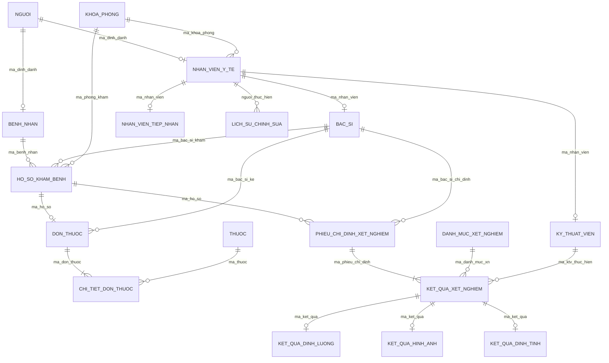

# 🗺️ LƯỢC ĐỒ QUAN HỆ CHUẨN HÓA HOÀN CHỈNH (RELATIONAL SCHEMA)
## Đề tài: CSDL Hồ sơ Khám bệnh và Kết quả Xét nghiệm có Lịch sử Chỉnh sửa
*(Toàn bộ các quan hệ đã được chứng minh đạt chuẩn BCNF và 4NF)*

---

## 1. DANH SÁCH LƯỢC ĐỒ QUAN HỆ (FORMAL RELATIONAL SCHEMAS)

Ký hiệu quy ước:
- **`Thuoc_tinh_in_dam_gach_chan`**: Khóa chính (Primary Key - PK).
- `Thuoc_tinh_in_nghieng`: Khóa ngoại (Foreign Key - FK).
- `[UK]`: Khóa duy nhất (Unique Key).

### 1.1. Phân hệ Nhân khẩu học & Quản trị Nhân sự
1. **`Nguoi`** (
   $\underline{\mathbf{ma\_dinh\_danh}}$, $\text{ho\_ten}$, $\text{ngay\_sinh}$, $\text{gioi\_tinh}$, $\text{dia\_chi}$, $\text{so\_dien\_thoai[]}$, $\text{ngay\_tao}$
)
   - *PK:* `ma_dinh_danh` (CCCD 12 ký tự)

2. **`BenhNhan`** (
   $\underline{\mathbf{ma\_benh\_nhan}}$, *$\text{ma\_dinh\_danh}$* [UK], $\text{nhom\_mau}$, $\text{tien\_su\_di\_ung}$, $\text{tien\_su\_benh}$
)
   - *PK:* `ma_benh_nhan`
   - *FK:* `ma_dinh_danh` $\rightarrow$ `Nguoi(ma_dinh_danh)` ON DELETE RESTRICT

3. **`KhoaPhong`** (
   $\underline{\mathbf{ma\_khoa\_phong}}$, $\text{ten\_khoa\_phong}$, $\text{loai\_phong}$, $\text{vi\_tri\_tang}$
)
   - *PK:* `ma_khoa_phong`

4. **`NhanVienYTe`** (
   $\underline{\mathbf{ma\_nhan\_vien}}$, *$\text{ma\_dinh\_danh}$* [UK], *$\text{ma\_khoa\_phong}$*, $\text{hoc\_vi}$, $\text{chuc\_vu}$, $\text{trang\_thai\_lam\_viec}$
)
   - *PK:* `ma_nhan_vien`
   - *FK1:* `ma_dinh_danh` $\rightarrow$ `Nguoi(ma_dinh_danh)` ON DELETE RESTRICT
   - *FK2:* `ma_khoa_phong` $\rightarrow$ `KhoaPhong(ma_khoa_phong)` ON DELETE RESTRICT

5. **`BacSi`** (
   $\underline{\mathbf{ma\_nhan\_vien}}$, $\text{chung\_chi\_hanh\_nghe}$ [UK], $\text{chuyen\_khoa\_chinh}$
)
   - *PK, FK:* `ma_nhan_vien` $\rightarrow$ `NhanVienYTe(ma_nhan_vien)` ON DELETE CASCADE

6. **`KyThuatVien`** (
   $\underline{\mathbf{ma\_nhan\_vien}}$, $\text{linh\_vuc\_chuyen\_trach}$, $\text{chung\_chi\_an\_toan\_buc\_xa}$
)
   - *PK, FK:* `ma_nhan_vien` $\rightarrow$ `NhanVienYTe(ma_nhan_vien)` ON DELETE CASCADE

7. **`NhanVienTiepNhan`** (
   $\underline{\mathbf{ma\_nhan\_vien}}$, $\text{quay\_tiep\_nhan}$
)
   - *PK, FK:* `ma_nhan_vien` $\rightarrow$ `NhanVienYTe(ma_nhan_vien)` ON DELETE CASCADE

---

### 1.2. Phân hệ Hồ sơ Khám bệnh Lâm sàng
8. **`HoSoKhamBenh`** (
   $\underline{\mathbf{ma\_ho\_so}}$, *$\text{ma\_benh\_nhan}$*, *$\text{ma\_bac\_si\_kham}$*, *$\text{ma\_phong\_kham}$*, $\text{thoi\_gian\_tiep\_nhan}$, $\text{thoi\_gian\_kham}$, $\text{mach}$, $\text{nhiet\_do}$, $\text{huyet\_ap\_tam\_thu}$, $\text{huyet\_ap\_tam\_truong}$, $\text{chieu\_cao}$, $\text{can\_nang}$, $\text{chi\_so\_bmi}$, $\text{ly\_do\_kham}$, $\text{chan\_doan\_so\_bo}$, $\text{chan\_doan\_xac\_dinh}$, $\text{loi\_dan\_bac\_si}$, $\text{ngay\_hen\_tai\_kham}$, $\text{trang\_thai\_kham}$, $\text{is\_deleted}$
)
   - *PK:* `ma_ho_so`
   - *FK1:* `ma_benh_nhan` $\rightarrow$ `BenhNhan(ma_benh_nhan)` ON DELETE RESTRICT
   - *FK2:* `ma_bac_si_kham` $\rightarrow$ `BacSi(ma_nhan_vien)` ON DELETE RESTRICT
   - *FK3:* `ma_phong_kham` $\rightarrow$ `KhoaPhong(ma_khoa_phong)` ON DELETE RESTRICT

---

### 1.3. Phân hệ Cận lâm sàng & Kết quả Xét nghiệm Đa hình
9. **`DanhMucXetNghiem`** (
   $\underline{\mathbf{ma\_danh\_muc\_xn}}$, $\text{ten\_xet\_nghiem}$, $\text{nhom\_xet\_nghiem}$, $\text{hinh\_thai\_ket\_qua}$, $\text{don\_gia\_dich\_vu}$, $\text{thoi\_gian\_chuan\_tra\_kq}$
)
   - *PK:* `ma_danh_muc_xn`

10. **`PhieuChiDinhXetNghiem`** (
    $\underline{\mathbf{ma\_phieu\_chi\_dinh}}$, *$\text{ma\_ho\_so}$*, *$\text{ma\_bac\_si\_chi\_dinh}$*, $\text{thoi\_gian\_chi\_dinh}$, $\text{trang\_thai\_phieu}$, $\text{ghi\_chu\_lam\_sang}$, $\text{is\_deleted}$
)
    - *PK:* `ma_phieu_chi_dinh`
    - *FK1:* `ma_ho_so` $\rightarrow$ `HoSoKhamBenh(ma_ho_so)` ON DELETE CASCADE
    - *FK2:* `ma_bac_si_chi_dinh` $\rightarrow$ `BacSi(ma_nhan_vien)` ON DELETE RESTRICT

11. **`KetQuaXetNghiem`** *(Siêu lớp)* (
    $\underline{\mathbf{ma\_ket\_qua}}$, *$\text{ma\_phieu\_chi\_dinh}$*, *$\text{ma\_danh\_muc\_xn}$*, *$\text{ma\_ktv\_thuc\_hien}$*, $\text{thoi\_gian\_tiep\_nhan\_mau}$, $\text{thoi\_gian\_co\_ket\_qua}$, $\text{trang\_thai\_ket\_qua}$, $\text{ket\_luan\_tong\_quat}$, $\text{so\_phien\_ban}$, $\text{is\_deleted}$
)
    - *PK:* `ma_ket_qua`
    - *FK1:* `ma_phieu_chi_dinh` $\rightarrow$ `PhieuChiDinhXetNghiem(ma_phieu_chi_dinh)` ON DELETE CASCADE
    - *FK2:* `ma_danh_muc_xn` $\rightarrow$ `DanhMucXetNghiem(ma_danh_muc_xn)` ON DELETE RESTRICT
    - *FK3:* `ma_ktv_thuc_hien` $\rightarrow$ `KyThuatVien(ma_nhan_vien)` ON DELETE SET NULL

12. **`KetQuaDinhLuong`** *(Kế thừa `KetQuaXetNghiem`)* (
    $\underline{\mathbf{ma\_ket\_qua}}$, $\dots$, $\text{gia\_tri\_do}$, $\text{don\_vi\_tinh}$, $\text{chi\_so\_min\_chuan}$, $\text{chi\_so\_max\_chuan}$, $\text{muc\_do\_canh\_bao}$
)

13. **`KetQuaHinhAnh`** *(Kế thừa `KetQuaXetNghiem`)* (
    $\underline{\mathbf{ma\_ket\_qua}}$, $\dots$, $\text{duong\_dan\_tep\_anh}$, $\text{ky\_thuat\_chup}$, $\text{vung\_khao\_sat}$, $\text{mo\_ta\_ton\_thuong}$
)

14. **`KetQuaDinhTinh`** *(Kế thừa `KetQuaXetNghiem`)* (
    $\underline{\mathbf{ma\_ket\_qua}}$, $\dots$, $\text{ket\_qua\_danh\_gia}$, $\text{ten\_chung\_vi\_khuan}$, $\text{mo\_ta\_vi\_sinh}$, $\text{khang\_sinh\_nhay\_cam[]}$
)

---

### 1.4. Phân hệ Kê đơn & Dược phẩm
15. **`Thuoc`** (
    $\underline{\mathbf{ma\_thuoc}}$, $\text{ten\_thuoc}$, $\text{hoat\_chat}$, $\text{ham\_luong}$, $\text{dang\_bao\_che}$, $\text{don\_vi\_tinh}$, $\text{don\_gia}$
)
    - *PK:* `ma_thuoc`

16. **`DonThuoc`** (
    $\underline{\mathbf{ma\_don\_thuoc}}$, *$\text{ma\_ho\_so}$* [UK], *$\text{ma\_bac\_si\_ke}$*, $\text{ngay\_ke\_don}$, $\text{loi\_dan\_chung}$, $\text{is\_deleted}$
)
    - *PK:* `ma_don_thuoc`
    - *FK1:* `ma_ho_so` $\rightarrow$ `HoSoKhamBenh(ma_ho_so)` ON DELETE CASCADE
    - *FK2:* `ma_bac_si_ke` $\rightarrow$ `BacSi(ma_nhan_vien)` ON DELETE RESTRICT

17. **`ChiTietDonThuoc`** *(Thực thể yếu)* (
    $\underline{\mathbf{ma\_don\_thuoc}}$, $\underline{\mathbf{so\_thu\_tu\_dong}}$, *$\text{ma\_thuoc}$*, $\text{so\_luong}$, $\text{lieu\_dung\_moi\_lan}$, $\text{so\_lan\_uong\_ngay}$, $\text{thoi\_diem\_uong}$, $\text{so\_ngay\_dung}$
)
    - *PK:* `(ma_don_thuoc, so_thu_tu_dong)`
    - *FK1:* `ma_don_thuoc` $\rightarrow$ `DonThuoc(ma_don_thuoc)` ON DELETE CASCADE
    - *FK2:* `ma_thuoc` $\rightarrow$ `Thuoc(ma_thuoc)` ON DELETE RESTRICT

---

### 1.5. Phân hệ Kiểm toán & Lịch sử Chỉnh sửa (Audit Trail)
18. **`LichSuChinhSua`** (
    $\underline{\mathbf{ma\_lich\_su}}$, $\text{ten\_bang}$, $\text{ma\_ban\_ghi}$, $\text{so\_phien\_ban}$, $\text{loai\_thao\_tac}$, $\text{du\_lieu\_cu (JSONB)}$, $\text{du\_lieu\_moi (JSONB)}$, $\text{ly\_do\_sua}$, *$\text{nguoi\_thuc\_hien}$*, $\text{thoi\_gian\_sua}$
)
    - *PK:* `ma_lich_su`
    - *FK:* `nguoi_thuc_hien` $\rightarrow$ `NhanVienYTe(ma_nhan_vien)` ON DELETE RESTRICT

---

## 2. SƠ ĐỒ LƯỢC ĐỒ QUAN HỆ LOGIC (RELATIONAL SCHEMA DIAGRAM)

