# 📋 MASTER PLAN — Đồ án CSDL Hồ sơ Khám bệnh & Kết quả Xét nghiệm
## Tiến độ 12 tuần | Ánh xạ 9 phần báo cáo

> [!IMPORTANT]
> **Đề tài:** Thiết kế CSDL hồ sơ khám bệnh và kết quả xét nghiệm có lịch sử chỉnh sửa
> **DBMS:** PostgreSQL (Object-Relational) | **Báo cáo:** 20–30 trang | **Mã nguồn:** GitHub

---

## Tổng quan ánh xạ: Báo cáo ↔ Tuần

```mermaid
flowchart LR
    subgraph "GIAI ĐOẠN 1: Phân tích & Thiết kế"
        W1["Tuần 1\nĐặc tả nghiệp vụ"]
        W2["Tuần 2\nSơ đồ EER"]
        W3["Tuần 3\nRàng buộc & Review"]
    end
    subgraph "GIAI ĐOẠN 2: Chuẩn hóa"
        W4["Tuần 4\nPhụ thuộc hàm & Khóa"]
        W5["Tuần 5\nChuẩn hóa & Lược đồ"]
    end
    subgraph "GIAI ĐOẠN 3: Hiện thực hóa"
        W6["Tuần 6\nDDL & Seed Data"]
        W7["Tuần 7\nSQL Nâng cao (1)"]
        W8["Tuần 8\nSQL Nâng cao (2)"]
    end
    subgraph "GIAI ĐOẠN 4: Chuyên sâu"
        W9["Tuần 9\nOOP & OQL"]
        W10["Tuần 10\nThực nghiệm"]
    end
    subgraph "GIAI ĐOẠN 5: Hoàn thiện"
        W11["Tuần 11\nTransaction & Test"]
        W12["Tuần 12\nBáo cáo & Bảo vệ"]
    end
    W1 --> W2 --> W3 --> W4 --> W5 --> W6 --> W7 --> W8 --> W9 --> W10 --> W11 --> W12
```



| Phần báo cáo | Tuần thực hiện | Điểm tối đa |
|---|---|---|
| **P1.** Giới thiệu và mục tiêu | Tuần 1 | — |
| **P2.** Phân tích yêu cầu | Tuần 1–2 | 1.5đ (gộp P3) |
| **P3.** Thiết kế mức quan niệm (EER) | Tuần 2–3 | ↑ |
| **P4.** Thiết kế mức logic & Chuẩn hóa | Tuần 4–5 | 2.0đ |
| **P5.** Thiết kế mức vật lý | Tuần 6 | — |
| **P6.** Phần chuyên sâu (Lịch sử chỉnh sửa & Đa hình kết quả) | Tuần 6, 9–10 | 1.5đ |
| **P7.** Kiểm thử & Đánh giá (Transaction & Hiệu năng) | Tuần 11 | 2.0đ |
| **P8.** Kết luận & Hướng phát triển | Tuần 12 | — |
| **P9.** Tài liệu tham khảo | Tuần 12 | — |
| *(Xuyên suốt)* SQL Nâng cao | Tuần 7–8 | 2.0đ |
| *(Xuyên suốt)* Báo cáo tổng hợp | Tuần 12 | 1.0đ |

---

## GIAI ĐOẠN 1 — PHÂN TÍCH & THIẾT KẾ QUAN NIỆM (Tuần 1–3)
**→ Phần báo cáo: P1, P2, P3 | Chuẩn đầu ra: Phân tích & Thiết kế (1.5đ)**

### 📅 Tuần 1 — Đặc tả nghiệp vụ & Khởi tạo dự án

**Công việc cụ thể:**
- [ ] **Khởi tạo repo GitHub** với cấu trúc thư mục chuẩn:
  ```
  CSDL_BenhVien/
  ├── docs/                  # Tài liệu & sơ đồ
  │   ├── eer/               # Sơ đồ EER
  │   ├── schemas/           # Lược đồ quan hệ
  │   └── data-dictionary/   # Từ điển dữ liệu
  ├── sql/
  │   ├── ddl/               # CREATE TABLE, TYPE, ...
  │   ├── dml/               # INSERT dữ liệu mẫu
  │   ├── queries/           # 10-12 truy vấn nâng cao
  │   ├── oop/               # Object-Relational & OQL
  │   └── transactions/      # 3 kịch bản transaction
  ├── tests/                 # Script kiểm thử
  ├── report/                # File báo cáo (.md / .docx)
  └── README.md
  ```
- [ ] **Viết mô tả nghiệp vụ** (Business Domain Description):
  - Quy trình khám bệnh: Bệnh nhân → Đăng ký → Khám → Chẩn đoán → Chỉ định xét nghiệm → Kết quả → Kê đơn
  - Xác định các actor chính: Bệnh nhân, Bác sĩ, Kỹ thuật viên XN, Nhân viên tiếp nhận
  - Mô tả nghiệp vụ lịch sử chỉnh sửa: Ai sửa, sửa gì, khi nào, lý do
  - Mô tả nghiệp vụ kết quả xét nghiệm đa hình: Kết quả số (glucose, huyết áp), kết quả hình ảnh (X-quang, MRI), kết quả văn bản (mô tả vi sinh)
- [ ] **Xác định các thực thể chính** (≥ 10 thực thể):
  - `BenhNhan`, `BacSi`, `KyThuatVien`, `NhanVien`
  - `HoSoKhamBenh`, `ChanDoan`, `DonThuoc`, `ChiTietDonThuoc`
  - `PhieuXetNghiem`, `KetQuaXetNghiem`, `LoaiXetNghiem`
  - `LichSuChinhSua` (audit trail)
  - `Thuoc`, `Khoa`, `PhongKham`
- [ ] **Viết phần P1 (Giới thiệu)** của báo cáo (1–2 trang)

**Sản phẩm bàn giao tuần 1:**
> Tài liệu đặc tả nghiệp vụ (`docs/business-description.md`), cấu trúc repo, bản nháp P1.

---

### 📅 Tuần 2 — Sơ đồ EER (Enhanced Entity-Relationship)

**Công việc cụ thể:**
- [ ] **Vẽ sơ đồ EER đầy đủ** bao gồm:
  - **Chuyên biệt hóa/Tổng quát hóa (Specialization/Generalization):**
    - `NguoiDung` ⟶ {`BacSi`, `KyThuatVien`, `NhanVienTiepNhan`} (disjoint, total)
    - `KetQuaXetNghiem` ⟶ {`KetQuaSo`, `KetQuaHinhAnh`, `KetQuaVanBan`} (overlapping, partial)
  - **Mối quan hệ n-ary** nếu phù hợp (ví dụ: BacSi-kham-BenhNhan-taiPhong)
  - **Thuộc tính đa trị** (ví dụ: số điện thoại bệnh nhân → Array trong PostgreSQL)
  - **Thuộc tính dẫn xuất** (ví dụ: tuổi = derived từ ngày sinh)
  - **Weak entity** nếu có (ví dụ: `ChiTietDonThuoc` phụ thuộc `DonThuoc`)
- [ ] **Ký hiệu EER chuẩn:** Dùng ký hiệu Chen hoặc Crow's Foot (recommend Crow's Foot cho dễ đọc), ghi chú rõ ràng cardinality (1:1, 1:N, M:N)
- [ ] **Xác định ràng buộc participation:** Total vs Partial cho mỗi mối quan hệ
- [ ] **Bắt đầu viết P2 (Phân tích yêu cầu)** — liệt kê yêu cầu chức năng và phi chức năng

**Sản phẩm bàn giao tuần 2:**
> Sơ đồ EER hoàn chỉnh (file ảnh + source), bản nháp P2.

---

### 📅 Tuần 3 — Ràng buộc, Từ điển dữ liệu & Review

**Công việc cụ thể:**
- [ ] **Lập từ điển dữ liệu (Data Dictionary)** cho mọi thực thể:

  | Thuộc tính | Kiểu dữ liệu | Ràng buộc | Mô tả |
  |---|---|---|---|
  | `ma_benh_nhan` | `CHAR(10)` | PK, NOT NULL | Mã bệnh nhân theo format BN-XXXXXXX |
  | `ho_ten` | `VARCHAR(100)` | NOT NULL | Họ và tên đầy đủ |
  | `ngay_sinh` | `DATE` | NOT NULL, CHECK(< NOW()) | Ngày sinh |
  | ... | ... | ... | ... |

- [ ] **Xác định toàn bộ ràng buộc toàn vẹn:**
  - Ràng buộc miền (domain): CHECK trên giá trị xét nghiệm, enum trạng thái
  - Ràng buộc khóa (key): PK, UNIQUE
  - Ràng buộc tham chiếu (referential): FK + hành vi ON DELETE/ON UPDATE
  - Ràng buộc nghiệp vụ (business): trigger/check đặc thù
- [ ] **Review & chốt thiết kế EER** — đối chiếu ngược lại với đặc tả nghiệp vụ
- [ ] **Hoàn thiện P2, P3** của báo cáo

**Sản phẩm bàn giao tuần 3:**
> Từ điển dữ liệu hoàn chỉnh, sơ đồ EER đã review, P2 + P3 hoàn thiện.

---

## GIAI ĐOẠN 2 — CHUẨN HÓA (Tuần 4–5)
**→ Phần báo cáo: P4 | Chuẩn đầu ra: Chuẩn hóa (2.0đ)**

### 📅 Tuần 4 — Phụ thuộc hàm, Bao đóng, Khóa

**Công việc cụ thể:**
- [ ] **Liệt kê tất cả phụ thuộc hàm (FD)** cho mỗi quan hệ. Ví dụ:
  ```
  HoSoKhamBenh:
    ma_ho_so → ma_benh_nhan, ma_bac_si, ngay_kham, chan_doan, ghi_chu
    ma_benh_nhan, ngay_kham → ma_ho_so  (nếu mỗi ngày chỉ khám 1 lần)
  ```
- [ ] **Tính bao đóng (Closure)** của các tập thuộc tính quan trọng: Chứng minh đâu là siêu khóa, đâu là khóa ứng viên
- [ ] **Tìm phủ tối thiểu (Minimal Cover / Canonical Cover)** cho mỗi tập FD:
  - Bước 1: Tách vế phải thành đơn thuộc tính
  - Bước 2: Loại bỏ thuộc tính dư thừa ở vế trái
  - Bước 3: Loại bỏ FD dư thừa
- [ ] **Xác định khóa chính và khóa ứng viên** cho mọi quan hệ

**Sản phẩm bàn giao tuần 4:**
> Tài liệu FD, bao đóng, phủ tối thiểu cho ≥ 5 quan hệ chính.

---

### 📅 Tuần 5 — Chuẩn hóa BCNF/3NF & Lược đồ quan hệ

**Công việc cụ thể:**
- [ ] **Kiểm tra từng quan hệ với BCNF:**
  - Với mỗi FD X → Y: kiểm tra X có phải siêu khóa không?
  - Nếu vi phạm: phân rã và kiểm tra tính **nối không mất mát (Lossless Join)**
- [ ] **Kiểm tra bảo toàn phụ thuộc (Dependency Preservation):**
  - Nếu BCNF không bảo toàn FD → giải thích tại sao chọn 3NF thay thế
  - Ghi rõ lựa chọn 3NF hay BCNF cho từng quan hệ và lý do
- [ ] **Phân tích 4NF** (phụ thuộc đa trị - MVD):
  - Xác định có MVD nào trong thiết kế không (ví dụ: Bác sĩ →→ Chuyên khoa, Bác sĩ →→ PhòngKhám)
  - Nếu có: phân rã đạt 4NF
  - Nếu không: giải thích tại sao thiết kế đã thỏa 4NF
- [ ] **Vẽ lược đồ quan hệ cuối cùng (Relational Schema Diagram)** — thể hiện PK, FK, các quan hệ
- [ ] **Viết phần P4** hoàn chỉnh với đầy đủ chứng minh

**Sản phẩm bàn giao tuần 5:**
> Tài liệu chuẩn hóa đầy đủ, lược đồ quan hệ cuối cùng, P4 hoàn thiện.

> [!TIP]
> **Chiến lược ghi điểm cao ở phần chuẩn hóa:** Không chỉ nói "bảng đã đạt BCNF". Hãy **chứng minh** bằng cách liệt kê từng FD, kiểm tra từng FD xem có vi phạm không, và kết luận. Phần 4NF dù không có MVD cũng nên viết 1 đoạn phân tích.

---

## GIAI ĐOẠN 3 — HIỆN THỰC HÓA (Tuần 6–8)
**→ Phần báo cáo: P5, P6 (một phần) | Chuẩn đầu ra: SQL Nâng cao (2.0đ)**

### 📅 Tuần 6 — DDL, Dữ liệu mẫu & Thiết kế vật lý

**Công việc cụ thể:**
- [ ] **Viết DDL hoàn chỉnh** (`sql/ddl/`):
  - `01_create_types.sql`: Custom TYPE, ENUM, DOMAIN
  - `02_create_tables.sql`: Tất cả bảng với PK, FK, CHECK, UNIQUE, DEFAULT
  - `03_create_indexes.sql`: Index cho các cột thường query (B-tree, GIN cho JSONB/Array)
  - `04_create_triggers.sql`: Trigger cho audit trail (lịch sử chỉnh sửa)
  - `05_create_views.sql`: View cho các báo cáo thường dùng
- [ ] **Thiết kế cơ chế lịch sử chỉnh sửa** (phần chuyên sâu P6):
  - **Phương án 1 — Audit Table:** Bảng `audit_log` chung lưu JSONB old/new values
  - **Phương án 2 — Shadow Tables:** Mỗi bảng chính có 1 bảng `_history` tương ứng
  - **Phương án 3 — Temporal Tables:** Sử dụng cặp cột `valid_from`/`valid_to`
  - → Phân tích trade-off và chọn phương án phù hợp nhất (recommend: kết hợp Audit Table + Shadow Table cho bảng quan trọng)
- [ ] **Thiết kế đa hình kết quả xét nghiệm** (phần chuyên sâu P6):
  - Sử dụng JSONB cho kết quả linh hoạt + CHECK constraint validation
  - Hoặc dùng table inheritance của PostgreSQL
- [ ] **Tạo dữ liệu mẫu** (`sql/dml/seed_data.sql`): ≥ 50 bệnh nhân, ≥ 200 hồ sơ khám, ≥ 500 kết quả XN
- [ ] **Viết P5 (Thiết kế mức vật lý)**

**Sản phẩm bàn giao tuần 6:**
> Toàn bộ DDL chạy được, dữ liệu mẫu, P5 + P6 (phần lịch sử chỉnh sửa).

---

### 📅 Tuần 7 — SQL Nâng cao (Phần 1: Truy vấn 1–6)

**Công việc cụ thể — Thiết kế 6 truy vấn đầu tiên:**
- [ ] **Q1 — Truy vấn con tương quan (Correlated Subquery):**
  Tìm bệnh nhân có kết quả xét nghiệm bất thường nhiều nhất trong 6 tháng gần nhất
- [ ] **Q2 — Multi-table JOIN + Aggregation:**
  Báo cáo tổng hợp số lượt khám, xét nghiệm, đơn thuốc theo bác sĩ theo tháng
- [ ] **Q3 — Window Function (RANK, LAG, LEAD):**
  So sánh kết quả xét nghiệm hiện tại với lần trước của cùng bệnh nhân (theo dõi xu hướng)
- [ ] **Q4 — CTE + Recursive Query:**
  Truy vấn chuỗi chuyển viện/chuyển khoa của bệnh nhân (nếu có) hoặc cấu trúc phân cấp khoa
- [ ] **Q5 — HAVING + Subquery:**
  Tìm các loại xét nghiệm có tỷ lệ kết quả bất thường > 30%
- [ ] **Q6 — EXISTS / NOT EXISTS:**
  Tìm bệnh nhân chưa bao giờ làm xét nghiệm nhưng đã khám > 3 lần

**Sản phẩm bàn giao tuần 7:**
> 6 file SQL chạy được + kết quả mẫu cho mỗi truy vấn.

---

### 📅 Tuần 8 — SQL Nâng cao (Phần 2: Truy vấn 7–12 + Stored Procedures)

**Công việc cụ thể — Thiết kế 6 truy vấn/nghiệp vụ còn lại:**
- [ ] **Q7 — Stored Procedure phức tạp:**
  Quy trình tạo hồ sơ khám bệnh hoàn chỉnh (đăng ký → khám → XN → kết quả → đơn thuốc) trong 1 transaction
- [ ] **Q8 — Dynamic SQL (EXECUTE FORMAT):**
  Báo cáo thống kê linh hoạt theo tiêu chí người dùng chọn (theo khoa, theo thời gian, theo loại XN)
- [ ] **Q9 — Stored Function trả về TABLE:**
  Hàm tìm kiếm bệnh nhân đa tiêu chí (tên, mã, ngày sinh, mã BHYT) trả về danh sách kết quả
- [ ] **Q10 — JSONB Query:**
  Truy vấn kết quả xét nghiệm lưu dạng JSONB — tìm tất cả XN có chỉ số glucose > 126 mg/dL
- [ ] **Q11 — Pivot / Crosstab (tablefunc):**
  Bảng tổng hợp kết quả XN theo thời gian dạng ma trận (cột = tháng, hàng = loại XN)
- [ ] **Q12 — Trigger + Function:**
  Tự động ghi log khi kết quả xét nghiệm bị chỉnh sửa (phục vụ audit trail)

**Sản phẩm bàn giao tuần 8:**
> 6 file SQL chạy được, bộ stored procedures/functions hoàn chỉnh.

> [!NOTE]
> **Lưu ý về 10–12 truy vấn:** Mỗi truy vấn cần kèm theo: (1) Mô tả nghiệp vụ bằng lời, (2) Câu SQL, (3) Giải thích kỹ thuật tại sao dùng cấu trúc đó, (4) Screenshot kết quả chạy. Đây là phần dễ lấy trọn 2.0đ nếu làm kỹ.

---

## GIAI ĐOẠN 4 — CHUYÊN SÂU: OOP & THỰC NGHIỆM (Tuần 9–10)
**→ Phần báo cáo: P6 (hoàn thiện) | Chuẩn đầu ra: CSDL Hướng đối tượng (1.5đ)**

### 📅 Tuần 9 — Thiết kế Object-Relational & OQL

**Công việc cụ thể:**
- [ ] **Thiết kế phân cấp 4–6 lớp (Class Hierarchy)** sử dụng PostgreSQL Object-Relational:
  ```
  Lớp 1: nguoi_dung_type        (base: ho_ten, ngay_sinh, sdt[])
  Lớp 2: bac_si_type            (kế thừa nguoi_dung_type + chuyen_khoa, chung_chi)
  Lớp 3: ky_thuat_vien_type     (kế thừa nguoi_dung_type + phong_xet_nghiem)
  Lớp 4: ket_qua_xn_type        (base: ngay_thuc_hien, trang_thai)
  Lớp 5: ket_qua_so_type        (kế thừa ket_qua_xn_type + gia_tri NUMERIC, don_vi)
  Lớp 6: ket_qua_hinh_anh_type  (kế thừa ket_qua_xn_type + duong_dan, mo_ta)
  ```
- [ ] **Triển khai bằng PostgreSQL:**
  - `CREATE TYPE ... AS (...)` — Composite types
  - `CREATE TABLE ... INHERITS (...)` — Table inheritance
  - `CREATE FUNCTION ... RETURNS ...` — Methods cho types
  - Sử dụng `OID`, `ARRAY`, `ROW` constructors
- [ ] **Viết ≥ 5 truy vấn OQL** (biểu diễn qua PostgreSQL):
  - OQL 1: Truy vấn với phương thức (method invocation)
  - OQL 2: Truy vấn trên tập hợp lồng (nested collection — Array)
  - OQL 3: Truy vấn kế thừa (query trên bảng cha tự động bao gồm bảng con)
  - OQL 4: Path expression qua object reference
  - OQL 5: Truy vấn FLATTEN / UNNEST trên Array
- [ ] **Viết phần P6 — mục CSDL hướng đối tượng**

**Sản phẩm bàn giao tuần 9:**
> Script OOP (`sql/oop/`), 5+ truy vấn OQL, P6 section OOP.

---

### 📅 Tuần 10 — Thực nghiệm & Tích hợp

**Công việc cụ thể:**
- [ ] **Chạy thực nghiệm end-to-end:**
  - Chạy lại toàn bộ DDL từ đầu (DROP + CREATE)
  - Nạp dữ liệu mẫu
  - Chạy từng truy vấn, chụp kết quả
  - Kiểm tra OOP queries
- [ ] **Đo hiệu năng cơ bản:**
  - `EXPLAIN ANALYZE` cho các truy vấn phức tạp
  - So sánh có/không có index
  - Ghi nhận thời gian thực thi
- [ ] **Hoàn thiện P6** — tích hợp cả 2 phần chuyên sâu:
  - Lịch sử chỉnh sửa (audit trail)
  - Đa hình kết quả xét nghiệm (JSONB + Inheritance)
- [ ] **Buffer time:** Xử lý các vấn đề phát sinh, fix bug

**Sản phẩm bàn giao tuần 10:**
> Hệ thống chạy end-to-end, kết quả EXPLAIN ANALYZE, P6 hoàn chỉnh.

---

## GIAI ĐOẠN 5 — KIỂM THỬ & HOÀN THIỆN (Tuần 11–12)
**→ Phần báo cáo: P7, P8, P9 | Chuẩn đầu ra: Transaction & Thực nghiệm (2.0đ) + Báo cáo (1.0đ)**

### 📅 Tuần 11 — Transaction & Kiểm thử Concurrency

**Công việc cụ thể — 3 kịch bản bắt buộc:**

- [ ] **Kịch bản 1 — Transaction thành công (Happy Path):**
  ```
  BEGIN;
    -- Tạo hồ sơ khám bệnh
    -- Tạo phiếu xét nghiệm
    -- Ghi kết quả xét nghiệm
    -- Kê đơn thuốc
  COMMIT;
  -- Verify: tất cả dữ liệu đã persist đúng
  ```

- [ ] **Kịch bản 2 — Lỗi giữa chừng (Partial Failure + Rollback):**
  ```
  BEGIN;
    -- Tạo hồ sơ khám bệnh ✓
    -- Tạo phiếu xét nghiệm ✓
    -- Ghi kết quả XN vi phạm CHECK constraint ✗
  ROLLBACK;
  -- Verify: KHÔNG có dữ liệu nào được ghi (atomicity)
  ```

- [ ] **Kịch bản 3 — Cạnh tranh giữa 2 phiên (Concurrency):**
  ```
  -- Phiên A (READ COMMITTED):     -- Phiên B (SERIALIZABLE):
  BEGIN;                             BEGIN;
  SELECT ket_qua FROM ...;          UPDATE ket_qua SET ...;
                                    COMMIT;
  SELECT ket_qua FROM ...;          -- Phiên A thấy gì?
  COMMIT;
  ```
  - Test với các isolation level: READ COMMITTED, REPEATABLE READ, SERIALIZABLE
  - Minh họa: dirty read, non-repeatable read, phantom read
  - Minh họa deadlock và cách xử lý

- [ ] **Mỗi kịch bản cần có:**
  - Script `.sql` chạy lại được (reproducible)
  - Nhật ký thực nghiệm (experiment log): timestamp, lệnh, kết quả
  - Giải thích lý thuyết: tại sao kết quả đúng với lý thuyết Transaction/ACID
- [ ] **Viết P7 (Kiểm thử & Đánh giá)** hoàn chỉnh

**Sản phẩm bàn giao tuần 11:**
> 3 script transaction (`sql/transactions/`), nhật ký thực nghiệm, P7 hoàn thiện.

> [!WARNING]
> **Kịch bản 3 (Concurrency) là phần khó nhất** và thường bị mất điểm. Cần mở 2 terminal PostgreSQL song song, ghi rõ thứ tự từng lệnh ở từng phiên, và chụp screenshot. Chúng ta sẽ làm từng bước cùng nhau.

---

### 📅 Tuần 12 — Viết báo cáo, Tổng hợp & Bảo vệ

**Công việc cụ thể:**
- [ ] **Tổng hợp báo cáo 20–30 trang:**
  - Ghép P1–P9 đã viết sẵn từ các tuần trước
  - Bổ sung P8 (Kết luận & Hướng phát triển)
  - Bổ sung P9 (Tài liệu tham khảo) — ≥ 5 nguồn (sách, paper, documentation)
  - Review format: mục lục, đánh số hình/bảng, font/cỡ chữ thống nhất
- [ ] **Chuẩn bị GitHub repository:**
  - README.md chi tiết (hướng dẫn cài đặt, chạy)
  - Đảm bảo mọi script chạy được từ scratch:
    ```bash
    psql -f sql/ddl/01_create_types.sql
    psql -f sql/ddl/02_create_tables.sql
    ...
    psql -f sql/dml/seed_data.sql
    ```
  - Thêm file `.sql` chạy tất cả theo thứ tự (`run_all.sql` hoặc `Makefile`)
- [ ] **Chuẩn bị slide bảo vệ** (nếu cần): 10–15 slides tóm tắt
- [ ] **Dry-run bảo vệ:** Tự chạy lại toàn bộ hệ thống 1 lần từ đầu

**Sản phẩm bàn giao tuần 12:**
> Báo cáo hoàn chỉnh, GitHub repo sạch sẽ, sẵn sàng bảo vệ.

---

## Checklist Chuẩn đầu ra Tổng hợp

| # | Chuẩn đầu ra | Điểm | Tuần | Trạng thái |
|---|---|---|---|---|
| 1 | Mô tả nghiệp vụ + EER (chuyên biệt hóa/tổng quát hóa) + Từ điển dữ liệu | 1.5 | 1–3 | ⬜ |
| 2 | FD, bao đóng, khóa, phủ tối thiểu, BCNF/3NF, 4NF, chứng minh LJ+DP | 2.0 | 4–5 | ⬜ |
| 3 | 10–12 truy vấn/nghiệp vụ SQL nâng cao (subquery, join, CTE, recursive, dynamic, procedure) | 2.0 | 7–8 | ⬜ |
| 4 | 4–6 lớp OOP (kế thừa, tập hợp, phương thức) + ≥ 5 OQL | 1.5 | 9 | ⬜ |
| 5 | 3 kịch bản transaction (success, rollback, concurrency 2 phiên) + script + log | 2.0 | 11 | ⬜ |
| 6 | Báo cáo 20–30 trang, 9 phần, mã nguồn trên GitHub | 1.0 | 12 | ⬜ |
| | **TỔNG** | **10.0** | | |

---

## Tài liệu tham khảo gợi ý (cho P9)

1. Elmasri, R. & Navathe, S. — *Fundamentals of Database Systems* (7th ed.)
2. Silberschatz, A. et al. — *Database System Concepts* (7th ed.)
3. PostgreSQL Documentation — https://www.postgresql.org/docs/current/
4. Date, C.J. — *An Introduction to Database Systems* (8th ed.)
5. Connolly, T. & Begg, C. — *Database Systems: A Practical Approach to Design, Implementation, and Management*

---

> [!TIP]
> **Cách làm việc cùng nhau:** Mỗi tuần, bạn chỉ cần nói "Tuần X — sẵn sàng" và tôi sẽ hướng dẫn chi tiết, viết code, review, và giải thích lý thuyết cho phần đó. Chúng ta sẽ đi từng bước, không bỏ sót bất kỳ chuẩn đầu ra nào.
