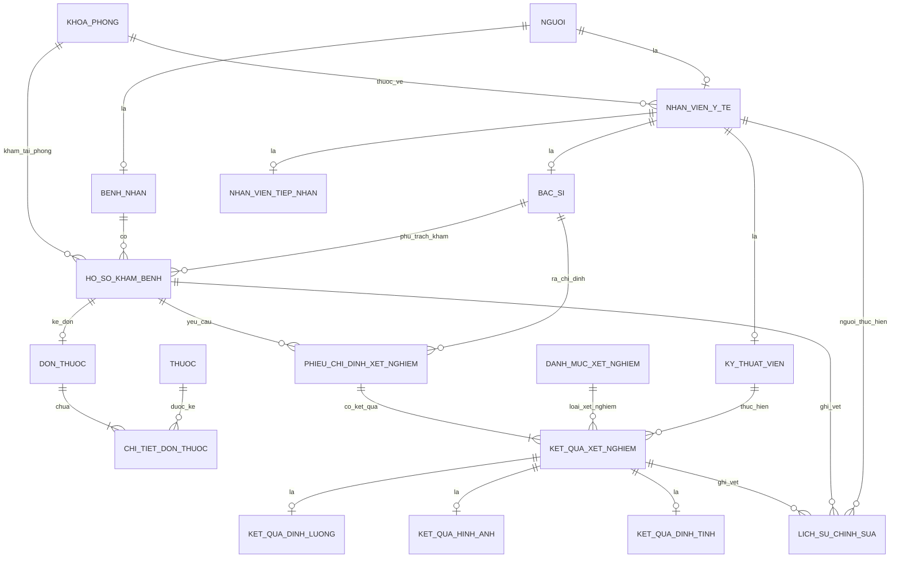

# PHẦN 3: THIẾT KẾ MỨC QUAN NIỆM (CONCEPTUAL DATABASE DESIGN)

---

## 3.1. Cơ sở Lý thuyết Mô hình Thực thể Kết hợp Mở rộng (EER)

Mô hình Thực thể Kết hợp Mở rộng (Enhanced Entity-Relationship - EER) là sự phát triển nâng cao của mô hình ER truyền thống, bổ sung các khái niệm trừu tượng hóa dữ liệu quan trọng như:
- **Tổng quát hóa (Generalization) / Chuyên biệt hóa (Specialization)**: Cho phép nhóm các thực thể có chung thuộc tính thành một siêu lớp (Superclass) và phân rã thành các lớp con (Subclasses) với những thuộc tính và mối quan hệ đặc thù riêng biệt.
- **Ràng buộc kế thừa**:
  - Ràng buộc phân tách (Disjointness Constraint): Rời rạc ($d$ - Disjoint) hoặc Chồng lặp ($o$ - Overlapping).
  - Ràng buộc tham gia (Completeness Constraint): Toàn phần ($t$ - Total) hoặc Bộ phận ($p$ - Partial).
- **Thuộc tính đa trị (Multi-valued Attributes)** và **Thuộc tính dẫn xuất (Derived Attributes)**.
- **Thực thể yếu (Weak Entity)** và **Mối quan hệ định danh (Identifying Relationship)**.

Trong đề tài quản lý hồ sơ khám bệnh và xét nghiệm y khoa, việc áp dụng mô hình EER là bắt buộc nhằm phản ánh chính xác cấu trúc tổ chức nhân sự bệnh viện và sự đa dạng về hình thái kết quả xét nghiệm cận lâm sàng.

---

## 3.2. Mô hình Chuyên biệt hóa & Tổng quát hóa trong Đề tài

Hệ thống xây dựng hai phân cấp kế thừa cốt lõi:

```
                          [ Nguoi (CCCD, Họ tên, Ngày sinh, ĐT[]) ]
                                          |
                         +----------------+----------------+
                         | (o, t) - Chồng lặp, Toàn phần    |
                         v                                 v
                 [ BenhNhan ]                       [ NhanVienYTe ]
                                                           |
                                      +--------------------+--------------------+
                                      | (d, t) - Rời rạc, Toàn phần             |
                                      v                    v                    v
                                  [ BacSi ]        [ KyThuatVien ]     [ NhanVienTiepNhan ]


             [ KetQuaXetNghiem (Mã KQ, Thời gian, Trạng thái, Phiên bản, Cờ xóa) ]
                                          |
                         +----------------+----------------+
                         | (d, t) - Rời rạc, Toàn phần     |
                         v                v                v
               [ KetQuaDinhLuong ]  [ KetQuaHinhAnh ] [ KetQuaDinhTinh ]
```

### 3.2.1. Phân cấp Cụm Con người & Bài toán Bác sĩ đi khám bệnh
- **Siêu lớp `Nguoi`**: Đóng vai trò là nguồn dữ liệu chuẩn duy nhất (Single Source of Truth) lưu trữ thông tin nhân thân cơ bản: Căn cước công dân (`ma_dinh_danh` - PK), họ tên, ngày sinh, giới tính, địa chỉ và mảng số điện thoại (`so_dien_thoai[]`).
- **Phân rã cấp 1 (`Nguoi` $\rightarrow$ `BenhNhan`, `NhanVienYTe`)**: Áp dụng ràng buộc **Chồng lặp, Toàn phần `(o, t)`**:
  - *Lý do kỹ thuật & thực tiễn y tế*: Bác sĩ hoặc nhân viên y tế hoàn toàn có thể bị ốm và đăng ký khám bệnh tại chính cơ sở y tế nơi mình đang công tác. Nếu áp dụng ràng buộc Rời rạc (Disjoint), hệ thống sẽ buộc phải tạo hai bản ghi nhân thân riêng biệt cho cùng một con người $\rightarrow$ dẫn đến dị thường trùng lặp dữ liệu công dân (CCCD, họ tên, ngày sinh).
  - *Giải pháp*: Ràng buộc Chồng lặp (`o`) cho phép một cá thể công dân vừa mang vai trò `NhanVienYTe` (có mã nhân viên, quản lý ca trực, chuyên khoa) vừa mang vai trò `BenhNhan` (có mã bệnh nhân, hồ sơ bệnh án, tiền sử dị ứng) mà vẫn dùng chung một mã định danh công dân duy nhất.
- **Phân rã cấp 2 (`NhanVienYTe` $\rightarrow$ `BacSi`, `KyThuatVien`, `NhanVienTiepNhan`)**: Áp dụng ràng buộc **Rời rạc, Toàn phần `(d, t)`**:
  - Trong cùng một hợp đồng lao động và vị trí công tác tại bệnh viện, một cán bộ y tế chỉ đảm nhận một chức danh chuyên trách chính.

### 3.2.2. Phân cấp Kết quả Xét nghiệm (Đa hình Cận lâm sàng)
- **Siêu lớp `KetQuaXetNghiem`**: Quản lý thông tin chung của mọi chỉ định thực hiện: Khóa chính `ma_ket_qua`, liên kết phiếu chỉ định, danh mục dịch vụ, thời gian thực hiện, trạng thái kết quả, token khóa lạc quan `so_phien_ban` và cờ xóa logic `is_deleted`.
- **Phân rã (`KetQuaXetNghiem` $\rightarrow$ `KetQuaDinhLuong`, `KetQuaHinhAnh`, `KetQuaDinhTinh`)**: Áp dụng ràng buộc **Rời rạc, Toàn phần `(d, t)`**:
  - *Disjoint ($d$)*: Một phép đo/chỉ số cụ thể chỉ có thể thuộc một hình thái duy nhất: hoặc là chỉ số đo lường sinh hóa (có giá trị số, đơn vị, ngưỡng chuẩn min-max), hoặc là ảnh chụp chẩn đoán hình ảnh (có tệp ảnh, kỹ thuật chụp, mô tả tổn thương), hoặc là vi sinh/định tính (có đánh giá Âm/Dương tính, kháng sinh đồ).
  - *Total ($t$)*: Mọi kết quả cận lâm sàng khi phát sinh đều phải thuộc về một hình thái cụ thể, không tồn tại kết quả phi cấu trúc vô định hình.
  - Cấu trúc này ánh xạ trực tiếp sang tính năng **Kế thừa bảng (Table Inheritance)** của PostgreSQL ở các tuần hiện thực hóa.

---

## 3.3. Các Thành phần Đặc biệt trong Mô hình EER

### 3.3.1. Thuộc tính Đa trị (Multi-valued Attributes)
- `so_dien_thoai` trong thực thể `Nguoi`: Một cá nhân có thể sở hữu nhiều số điện thoại (số cá nhân, số gia đình bảo lãnh). Được thiết kế dạng kiểu mảng `TEXT[]` trong PostgreSQL, vừa bảo toàn tính trực quan của EER, vừa khai thác được chỉ mục `GIN Index` tốc độ cao.
- `khang_sinh_nhay_cam` trong `KetQuaDinhTinh`: Danh sách các hoạt chất kháng sinh mà chủng vi khuẩn phân lập thể hiện mức độ nhạy cảm (dạng mảng chuỗi `TEXT[]`).

### 3.3.2. Thuộc tính Dẫn xuất (Derived Attributes)
- `tuoi`: Dẫn xuất tự động từ `ngay_sinh` của `Nguoi` và ngày hiện tại:
  $$\text{tuoi} = \text{EXTRACT(YEAR FROM CURRENT\_DATE)} - \text{EXTRACT(YEAR FROM ngay\_sinh)}$$
- `chi_so_bmi`: Trong `HoSoKhamBenh`, được tính toán tự động từ chiều cao và cân nặng lâm sàng:
  $$\text{BMI} = \frac{\text{can\_nang (kg)}}{\left(\frac{\text{chieu\_cao (cm)}}{100}\right)^2}$$

### 3.3.3. Thực thể Yếu (Weak Entity) & Quan hệ Định danh
- Thực thể **`ChiTietDonThuoc`** là một thực thể yếu, không có ý nghĩa tồn tại độc lập nếu thiếu thực thể chủ **`DonThuoc`**.
- **Khóa bộ phận (Partial Key / Discriminator)**: `so_thu_tu_dong` (Số thứ tự dòng thuốc: 1, 2, 3...).
- **Khóa chính nhận diện**: Kết hợp giữa khóa chính của thực thể chủ và khóa bộ phận:
  $$\text{PK}(\text{ChiTietDonThuoc}) = \{\text{ma\_don\_thuoc}, \text{so\_thu\_tu\_dong}\}$$
- Ràng buộc toàn vẹn tham chiếu áp dụng cơ chế xóa lan truyền (`ON DELETE CASCADE`): Khi đơn thuốc bị hủy bỏ, toàn bộ các dòng chi tiết cấu thành đơn tự động bị xóa bỏ tương ứng.

---

## 3.4. Sơ đồ EER Tổng thể và Ma trận Ràng buộc Bản số

### 3.4.1. Sơ đồ EER (Crow's Foot Notation)



### 3.4.2. Bảng Phân tích Bản số & Tham gia (Cardinality & Participation)

| Mối quan hệ | Thực thể tham gia | Bản số | Tham gia | Ràng buộc nghiệp vụ y tế |
|---|---|:---:|:---:|---|
| **Thuộc khoa** | `KhoaPhong` $\leftrightarrow$ `NhanVienYTe` | $1 : N$ | Total bên Nhân viên | Một nhân viên y tế bắt buộc phải được biên chế vào đúng 1 khoa/phòng; một khoa có thể có nhiều hoặc chưa có nhân viên. |
| **Đợt khám** | `BenhNhan` $\leftrightarrow$ `HoSoKhamBenh` | $1 : N$ | Total bên Hồ sơ | Mỗi hồ sơ khám bệnh bắt buộc thuộc về đúng 1 bệnh nhân cụ thể. |
| **Phụ trách khám**| `BacSi` $\leftrightarrow$ `HoSoKhamBenh` | $1 : N$ | Total bên Hồ sơ | Mỗi đợt khám phải có đúng 1 bác sĩ chuyên khoa phụ trách chuyên môn. |
| **Kê đơn** | `HoSoKhamBenh` $\leftrightarrow$ `DonThuoc` | $1 : 1$ | Partial cả hai bên | Một lượt khám có tối đa 1 đơn thuốc chính; có những lượt khám không phát sinh đơn thuốc (chỉ tư vấn). |
| **Chi tiết đơn** | `DonThuoc` $\leftrightarrow$ `ChiTietDonThuoc`| $1 : N$ | Total cả hai bên | Mối quan hệ định danh thực thể yếu: Đơn thuốc sinh ra phải có ít nhất 1 loại thuốc; dòng thuốc phải thuộc về 1 đơn. |
| **Thuốc được kê**| `Thuoc` $\leftrightarrow$ `ChiTietDonThuoc` | $1 : N$ | Partial bên Thuốc | Một loại thuốc trong kho có thể xuất hiện trong nhiều đơn thuốc khác nhau. |
| **Yêu cầu cận LS**| `HoSoKhamBenh` $\leftrightarrow$ `PhieuChiDinhXN`| $1 : N$ | Partial bên Hồ sơ | Đợt khám có thể chỉ định 0 hoặc nhiều phiếu xét nghiệm khác nhau. |
| **Hạng mục XN** | `PhieuChiDinhXN` $\leftrightarrow$ `KetQuaXetNghiem`| $1 : N$ | Total cả hai bên | Một phiếu chỉ định bao gồm 1 hoặc nhiều hạng mục xét nghiệm con. |
| **KTV thực hiện** | `KyThuatVien` $\leftrightarrow$ `KetQuaXetNghiem`| $1 : N$ | Partial bên Kết quả | Khi vừa tạo chỉ định thì chưa có KTV; khi thực hiện xong bắt buộc ký xác nhận mã KTV. |

---

## 3.5. Cơ chế Lưu vết Lịch sử & Kiểm soát Tương tranh ở Mức Quan niệm

Hệ thống kết hợp ba cơ chế kiểm soát dữ liệu bổ trợ lẫn nhau:
1. **Khóa Lạc quan (Optimistic Locking) qua `so_phien_ban`**: 
   - Đóng vai trò là số phiên bản dữ liệu (bắt đầu từ 1, tăng dần sau mỗi lần đính chính).
   - Trong môi trường mạng y tế có hàng trăm máy trạm, kỹ thuật viên đọc kết quả và gửi yêu cầu sửa đổi kèm theo phiên bản lúc đọc:
     $$\text{UPDATE} \dots \text{SET} \dots, \text{so\_phien\_ban} = \text{so\_phien\_ban} + 1 \dots \text{WHERE ma\_ket\_qua} = X \text{ AND so\_phien\_ban} = V_{\text{old}}$$
   - Nếu một phiên khác đã sửa trước (làm thay đổi $V_{\text{old}}$), thao tác cập nhật sẽ trả về 0 dòng bị ảnh hưởng $\rightarrow$ Hệ thống phát hiện xung đột và cảnh báo người dùng ngay lập tức, loại bỏ hoàn toàn nguy cơ mất dữ liệu (Lost Update).
2. **Xóa mềm (Soft Delete) qua `is_deleted`**:
   - Dữ liệu y tế tuyệt đối không bị xóa vật lý. Các chỉ định bị hủy do nhầm lẫn chỉ được cập nhật cờ `is_deleted = TRUE`.
   - Các truy vấn nghiệp vụ hàng ngày của bác sĩ được tối ưu thông qua Partial Index trên PostgreSQL (`WHERE is_deleted = FALSE`).
3. **Nhật ký Kiểm toán Bất biến (Immutable Audit Log) qua `lich_su_chinh_sua`**:
   - Bảng nhật ký độc lập lưu trữ snapshot dạng `JSONB` của dữ liệu trước (`du_lieu_cu`) và sau (`du_lieu_moi`) khi biến động.
   - Bắt buộc ghi nhận thời điểm (`CURRENT_TIMESTAMP`), danh tính người sửa và lý do giải trình y khoa (`ly_do_sua`).

