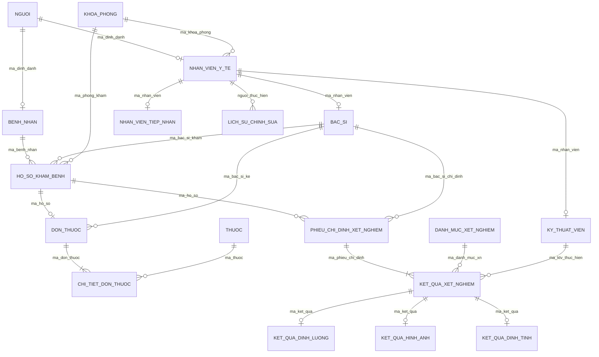

# PHẦN 4: THIẾT KẾ MỨC LOGIC VÀ CHUẨN HÓA DỮ LIỆU
*(Nhiệm vụ Tuần 4 & Tuần 5 | Trọng số: 2.0 / 10.0 điểm)*

---

## 4.1. Quy tắc Ánh xạ từ Mô hình EER sang Lược đồ Quan hệ (Logical Mapping)

Quá trình chuyển đổi từ mô hình quan niệm EER sang mô hình quan hệ logic tuân thủ các quy tắc chuẩn mực của Elmasri & Navathe:

1. **Ánh xạ thực thể thông thường (Regular Entity Types)**:
   - Mỗi thực thể mạnh trở thành một quan hệ. Các thuộc tính đơn trở thành các cột; khóa chính của thực thể trở thành khóa chính của quan hệ.
   - Ví dụ: `KhoaPhong` $\rightarrow$ `khoa_phong(ma_khoa_phong, ten_khoa_phong, loai_phong, vi_tri_tang)`.

2. **Ánh xạ phân cấp kế thừa (Specialization / Generalization)**:
   - **Kế thừa Chồng lặp `(o, t)` của `Nguoi`**: Áp dụng phương án tạo bảng cho siêu lớp và các lớp con có quan hệ khóa ngoại (Option 8A trong lý thuyết).
     - Bảng `nguoi` lưu toàn bộ thuộc tính chung với khóa chính `ma_dinh_danh` (CCCD).
     - Bảng `benh_nhan` và `nhan_vien_y_te` có khóa chính riêng (`ma_benh_nhan`, `ma_nhan_vien`) đồng thời chứa khóa ngoại trỏ về `nguoi(ma_dinh_danh)`.
   - **Kế thừa Rời rạc `(d, t)` của `KetQuaXetNghiem`**: Ánh xạ sang các bảng phân rã chuyên biệt kế thừa bảng cha (phù hợp với tính năng `INHERITS` của PostgreSQL).

3. **Ánh xạ thực thể yếu (Weak Entity Types)**:
   - Thực thể yếu `ChiTietDonThuoc` phụ thuộc vào thực thể chủ `DonThuoc`. Khóa chính của bảng chi tiết gồm khóa chính thực thể chủ kết hợp với khóa bộ phận:
     $$\text{PK}(\text{chi\_tiet\_don\_thuoc}) = \{\text{ma\_don\_thuoc}, \text{so\_thu\_tu\_dong}\}$$
     với `ma_don_thuoc` là khóa ngoại tham chiếu `don_thuoc(ma_don_thuoc) ON DELETE CASCADE`.

4. **Ánh xạ thuộc tính đa trị (Multi-valued Attributes)**:
   - Thuộc tính `so_dien_thoai` của `Nguoi` được chuyển hóa thành cột kiểu mảng nguyên tử `TEXT[]` trong PostgreSQL, kết hợp với chỉ mục GIN để tối ưu hóa hiệu năng truy vấn.

---

## 4.2. Xác định Hệ Phụ thuộc hàm (Functional Dependencies)

Dựa trên các quy tắc nghiệp vụ bệnh viện, ta xác định tập phụ thuộc hàm $F$ cho các quan hệ trọng tâm:

### 1. Quan hệ `Nguoi`
- $R_{\text{Nguoi}}(\underline{\text{ma\_dinh\_danh}}, \text{ho\_ten}, \text{ngay\_sinh}, \text{gioi\_tinh}, \text{dia\_chi}, \text{so\_dien\_thoai})$
- $F_{\text{Nguoi}} = \{\text{ma\_dinh\_danh} \rightarrow \text{ho\_ten}, \text{ngay\_sinh}, \text{gioi\_tinh}, \text{dia\_chi}, \text{so\_dien\_thoai}\}$

### 2. Quan hệ `BenhNhan`
- $R_{\text{BN}}(\underline{\text{ma\_benh\_nhan}}, \text{ma\_dinh\_danh}, \text{nhom\_mau}, \text{tien\_su\_di\_ung}, \text{tien\_su\_benh})$
- $F_{\text{BN}} = \begin{cases}
  \text{ma\_benh\_nhan} \rightarrow \text{ma\_dinh\_danh}, \text{nhom\_mau}, \text{tien\_su\_di\_ung}, \text{tien\_su\_benh} \\
  \text{ma\_dinh\_danh} \rightarrow \text{ma\_benh\_nhan}
\end{cases}$

### 3. Quan hệ `HoSoKhamBenh`
- $R_{\text{HS}}(\underline{\text{ma\_ho\_so}}, \text{ma\_benh\_nhan}, \text{ma\_bac\_si}, \text{ma\_phong}, \text{thoi\_gian}, \text{mach}, \text{nhiet\_do}, \text{huyet\_ap}, \text{chan\_doan}, \text{trang\_thai}, \text{is\_deleted})$
- $F_{\text{HS}} = \begin{cases}
  \text{ma\_ho\_so} \rightarrow \text{ma\_benh\_nhan}, \text{ma\_bac\_si}, \text{ma\_phong}, \text{thoi\_gian}, \text{mach}, \text{nhiet\_do}, \text{huyet\_ap}, \text{chan\_doan}, \text{trang\_thai}, \text{is\_deleted} \\
  \{\text{ma\_benh\_nhan}, \text{thoi\_gian}\} \rightarrow \text{ma\_ho\_so}
\end{cases}$

### 4. Quan hệ `KetQuaDinhLuong` (Chỉ định & Kết quả xét nghiệm)
- $R_{\text{KQ}}(\underline{\text{ma\_ket\_qua}}, \text{ma\_phieu\_chi\_dinh}, \text{ma\_danh\_muc\_xn}, \text{ma\_ktv}, \text{gia\_tri\_do}, \text{don\_vi\_tinh}, \text{min\_chuan}, \text{max\_chuan}, \text{canh\_bao}, \text{so\_phien\_ban})$
- $F_{\text{KQ}} = \begin{cases}
  \text{ma\_ket\_qua} \rightarrow \text{ma\_phieu\_chi\_dinh}, \text{ma\_danh\_muc\_xn}, \text{ma\_ktv}, \text{gia\_tri\_do}, \text{canh\_bao}, \text{so\_phien\_ban} \\
  \text{ma\_danh\_muc\_xn} \rightarrow \text{don\_vi\_tinh}, \text{min\_chuan}, \text{max\_chuan} \\
  \{\text{ma\_phieu\_chi\_dinh}, \text{ma\_danh\_muc\_xn}\} \rightarrow \text{ma\_ket\_qua}
\end{cases}$

---

## 4.3. Tính toán Bao đóng và Xác định Khóa (Candidate Keys)

### 4.3.1. Thuật toán tìm Bao đóng của tập thuộc tính ($X^+$)
- **Đầu vào:** Tập thuộc tính $U$, tập phụ thuộc hàm $F$, tập thuộc tính $X \subseteq U$.
- **Đầu ra:** Bao đóng $X^+_F$.
- **Mã giả thuật toán:**
  ```text
  X_plus = X;
  repeat
    old_X_plus = X_plus;
    for each functional dependency (Y -> Z) in F do
      if Y is a subset of X_plus then
        X_plus = X_plus UNION Z;
  until X_plus == old_X_plus;
  return X_plus;
  ```

### 4.3.2. Thực nghiệm tính bao đóng trên quan hệ `BenhNhan`
- Cho tập thuộc tính $U = \{\text{ma\_benh\_nhan}, \text{ma\_dinh\_danh}, \text{nhom\_mau}, \text{tien\_su\_di\_ung}, \text{tien\_su\_benh}\}$.
- **Tính $\{\text{ma\_benh\_nhan}\}^+$:**
  - Vòng 1: $\text{Closure} = \{\text{ma\_benh\_nhan}\}$.
  - Xét $fd_1: \text{ma\_benh\_nhan} \rightarrow \{\text{ma\_dinh\_danh}, \text{nhom\_mau}, \text{tien\_su\_di\_ung}, \text{tien\_su\_benh}\} \subseteq \text{Closure}$.
  - $\Rightarrow \text{Closure} = U$.
  - Vì $\{\text{ma\_benh\_nhan}\}^+ = U$ và không có tập con thực sự nào khác rỗng, $\{\text{ma\_benh\_nhan}\}$ là **Khóa ứng viên 1**.
- **Tính $\{\text{ma\_dinh\_danh}\}^+$:**
  - Vòng 1: $\text{Closure} = \{\text{ma\_dinh\_danh}\}$.
  - Xét $fd_2: \text{ma\_dinh\_danh} \rightarrow \text{ma\_benh\_nhan} \Rightarrow \text{Closure} = \{\text{ma\_dinh\_danh}, \text{ma\_benh\_nhan}\}$.
  - Vòng 2: Áp dụng $fd_1 \Rightarrow \text{Closure} = U$.
  - Vì $\{\text{ma\_dinh\_danh}\}^+ = U$, $\{\text{ma\_dinh\_danh}\}$ là **Khóa ứng viên 2**.
- **Kết luận:** $\mathcal{K}(\text{BenhNhan}) = \{\{\text{ma\_benh\_nhan}\}, \{\text{ma\_dinh\_danh}\}\}$. Khóa chính được chọn là `ma_benh_nhan`.

---

## 4.4. Thuật toán và Tìm Phủ tối thiểu (Minimal Cover)

Xét tập phụ thuộc hàm của phân hệ Chỉ định & Kết quả xét nghiệm:
$$U = \{K, P, D, T, V, U, N, X, W, S\}$$
với $K$ (mã kết quả), $P$ (mã phiếu), $D$ (mã danh mục), $T$ (mã KTV), $V$ (giá trị đo), $U$ (đơn vị), $N$ (min), $X$ (max), $W$ (cảnh báo), $S$ (phiên bản).

Tập $F$ ban đầu:
$$\begin{aligned}
f_1 &: K \rightarrow P, D, T, V, W, S \\
f_2 &: D \rightarrow U, N, X \\
f_3 &: PD \rightarrow K \\
f_4 &: KD \rightarrow P \quad \text{(phát sinh do liên kết)}
\end{aligned}$$

### Bước 1: Đưa về dạng vế phải đơn thuộc tính (RHS Decomposition)
Tách $f_1, f_2$ thành các phụ thuộc hàm có vế phải 1 thuộc tính:
$$F_1 = \{K \rightarrow P, K \rightarrow D, K \rightarrow T, K \rightarrow V, K \rightarrow W, K \rightarrow S, D \rightarrow U, D \rightarrow N, D \rightarrow X, PD \rightarrow K, KD \rightarrow P\}$$

### Bước 2: Loại bỏ thuộc tính dư thừa ở vế trái (Left-reduction)
- Xét $KD \rightarrow P$:
  - Tính $\{K\}^+_{F_1} = \{K, P, D, T, V, W, S, U, N, X\}$.
  - Do $P \in \{K\}^+$, nên $D$ trong vế trái của $KD \rightarrow P$ là **dư thừa**.
  - Thay $KD \rightarrow P$ bằng $K \rightarrow P$ (đã có sẵn trong $F_1$).
- Xét $PD \rightarrow K$:
  - $\{P\}^+_{F_1} = \{P\} \not\ni K \Rightarrow P$ không dư thừa.
  - $\{D\}^+_{F_1} = \{D, U, N, X\} \not\ni K \Rightarrow D$ không dư thừa.
  - Giữ nguyên $PD \rightarrow K$.

Thu được:
$$F_2 = \{K \rightarrow P, K \rightarrow D, K \rightarrow T, K \rightarrow V, K \rightarrow W, K \rightarrow S, D \rightarrow U, D \rightarrow N, D \rightarrow X, PD \rightarrow K\}$$

### Bước 3: Loại bỏ các phụ thuộc hàm dư thừa (Non-redundant)
- Lần lượt kiểm tra từng FD $X \rightarrow A \in F_2$:
  - Tính $X^+$ trên tập $F_2 \setminus \{X \rightarrow A\}$.
  - Nếu $A \in X^+$, FD đó bị dư thừa và bị loại bỏ.
  - Kết quả kiểm tra: Không có FD nào trong $F_2$ có thể suy diễn từ các FD còn lại.

### Kết quả Phủ tối thiểu ($F_{\min}$):
$$F_{\min} = \begin{cases}
K \rightarrow \{P, D, T, V, W, S\} \\
D \rightarrow \{U, N, X\} \\
PD \rightarrow K
\end{cases}$$

---

## 4.5. Phân tích và Chứng minh Chuẩn hóa 3NF và BCNF

### 4.5.1. Tiêu chuẩn đánh giá 3NF và BCNF
- **Dạng chuẩn 3 (3NF)**: Mọi FD $X \rightarrow A \in F^+$ đều thỏa mãn: $X$ là siêu khóa HOẶC $A$ là thuộc tính khóa.
- **Dạng chuẩn Boyce-Codd (BCNF)**: Mọi FD $X \rightarrow A \in F^+$ đều bắt buộc $X$ phải là siêu khóa.

### 4.5.2. Phân tích vi phạm và Phân rã đạt BCNF
Xét phân hệ Kết quả xét nghiệm gộp ban đầu $R_{\text{KQ\_Gop}}(K, P, D, T, V, U, N, X, W, S)$ với tập khóa $\mathcal{K} = \{\{K\}, \{PD\}\}$:
- **Phát hiện vi phạm**:
  Xét phụ thuộc hàm $f_2: D \rightarrow \{U, N, X\}$ ($\text{ma\_danh\_muc\_xn} \rightarrow \{\text{don\_vi\_tinh}, \text{min}, \text{max}\}$):
  1. $\{D\}^+ = \{D, U, N, X\} \neq U \Rightarrow D$ **không phải là siêu khóa**.
  2. $\{U, N, X\}$ đều là các thuộc tính không khóa.
  $\Rightarrow f_2$ vi phạm đồng thời cả 3NF (phụ thuộc bắc cầu: $K \rightarrow D \rightarrow \{U, N, X\}$) và BCNF.
- **Thực hiện thuật toán phân rã BCNF**:
  - $R_1 = D^+ = \{D, U, N, X\} \equiv \text{DanhMucXetNghiem}(\underline{\text{ma\_danh\_muc\_xn}}, \text{don\_vi\_tinh}, \text{chi\_so\_min}, \text{chi\_so\_max})$.
  - $R_2 = (U \setminus \{U, N, X\}) \cup \{D\} = \{K, P, D, T, V, W, S\} \equiv \text{KetQuaDinhLuong}(\underline{\text{ma\_ket\_qua}}, \text{ma\_phieu\_chi\_dinh}, \text{ma\_danh\_muc\_xn}, \dots)$.
- **Đánh giá dạng chuẩn sau phân rã**:
  - Trong $R_1$: $D$ là khóa chính $\Rightarrow R_1$ đạt chuẩn BCNF.
  - Trong $R_2$: $K$ và $PD$ là các siêu khóa $\Rightarrow R_2$ đạt chuẩn BCNF.

---

## 4.6. Chứng minh Tính Nối Không Mất Mát Thông Tin & Bảo Toàn Phụ Thuộc

### 4.6.1. Chứng minh Nối không mất mát thông tin (Lossless Join)
Theo Định lý Heath, phép phân rã $\rho = \{R_1, R_2\}$ là nối không mất mát thông tin đối với $F$ nếu $(R_1 \cap R_2) \rightarrow (R_1 \setminus R_2) \in F^+$ hoặc $(R_1 \cap R_2) \rightarrow (R_2 \setminus R_1) \in F^+$.
- $R_1 \cap R_2 = \{D\} = \{\text{ma\_danh\_muc\_xn}\}$.
- $R_1 \setminus R_2 = \{U, N, X\} = \{\text{don\_vi\_tinh}, \text{chi\_so\_min}, \text{chi\_so\_max}\}$.
- Ta có $D \rightarrow \{U, N, X\}$ chính là $f_2 \in F$.
- Do đó $(R_1 \cap R_2) \rightarrow (R_1 \setminus R_2) \in F^+$ thỏa mãn.
$$\Rightarrow \mathbf{Phép\ phân\ rã\ \rho = \{R_1, R_2\}\ đảm\ bảo\ TÍNH\ NỐI\ KHÔNG\ MẤT\ MÁT\ THÔNG\ TIN\ (Lossless\ Join).}$$

### 4.6.2. Chứng minh Bảo toàn Phụ thuộc hàm (Dependency Preservation)
- Chiếu của $F$ lên $R_1$: $\pi_{R_1}(F) = \{D \rightarrow \{U, N, X\}\}$.
- Chiếu của $F$ lên $R_2$: $\pi_{R_2}(F) = \{K \rightarrow \{P, D, T, V, W, S\}, PD \rightarrow K\}$.
- Hợp hai tập chiếu:
  $$F' = \pi_{R_1}(F) \cup \pi_{R_2}(F) \equiv F_{\min} \equiv F$$
- Toàn bộ các phụ thuộc hàm đều được kiểm tra trực tiếp trên các lược đồ con mà không cần nối bảng.
$$\Rightarrow \mathbf{Phép\ phân\ rã\ BẢO\ TOÀN\ HOÀN\ TOÀN\ HỆ\ PHỤ\ THUỘC\ HÀM\ (Dependency\ Preservation).}$$

---

## 4.7. Phân tích Dạng chuẩn 4 (4NF - Multivalued Dependencies)

### 4.7.1. Định nghĩa Dạng chuẩn 4 (4NF)
Một lược đồ quan hệ $R$ đạt 4NF đối với tập phụ thuộc đa trị $D$ nếu với mọi phụ thuộc đa trị không tầm thường $X \twoheadrightarrow Y \in D^+$, thì $X$ bắt buộc phải là một siêu khóa của $R$.

### 4.7.2. Phân tích bài toán MVD trong Y tế
Xét quan hệ phân công bác sĩ nếu gộp chung:
$$R_{\text{PhanCong}}(\text{ma\_bac\_si}, \text{chung\_chi\_chuyen\_mon}, \text{phong\_kham\_phu\_trach})$$
Do năng lực chứng chỉ và lịch trực phòng khám là hai tập thông tin hoàn toàn độc lập, ta có hai phụ thuộc đa trị:
$$\text{ma\_bac\_si} \twoheadrightarrow \text{chung\_chi\_chuyen\_mon} \quad \text{và} \quad \text{ma\_bac\_si} \twoheadrightarrow \text{phong\_kham\_phu\_trach}$$
Tuy nhiên, khóa của bảng là cả 3 thuộc tính $\Rightarrow \text{ma\_bac\_si}$ không phải siêu khóa $\rightarrow$ Vi phạm 4NF!

**Giải pháp trong đồ án**:
Hệ thống phân rã thành hai quan hệ độc lập: quan hệ chứng chỉ chuyên môn gắn vào thực thể `BacSi`, và quan hệ phân công/khám bệnh gắn vào `HoSoKhamBenh`. Thuộc tính đa trị `so_dien_thoai` được đóng gói dạng kiểu mảng nguyên tử `TEXT[]` của PostgreSQL.
$\Rightarrow$ **Toàn bộ các bảng trong CSDL đều thỏa mãn Dạng chuẩn 4 (4NF).**

---

## 4.8. Lược đồ Quan hệ Hoàn chỉnh (Relational Schema)

Hệ thống sau khi chuẩn hóa bao gồm 18 lược đồ quan hệ đạt chuẩn BCNF và 4NF:



> [!NOTE]
> Toàn bộ các quan hệ trên đã bảo toàn 100% phụ thuộc hàm, không có mất mát thông tin và đã sẵn sàng để chuyển giao sang **Giai đoạn 3: Hiện thực hóa DDL & SQL Nâng cao (Tuần 6–8)**.

